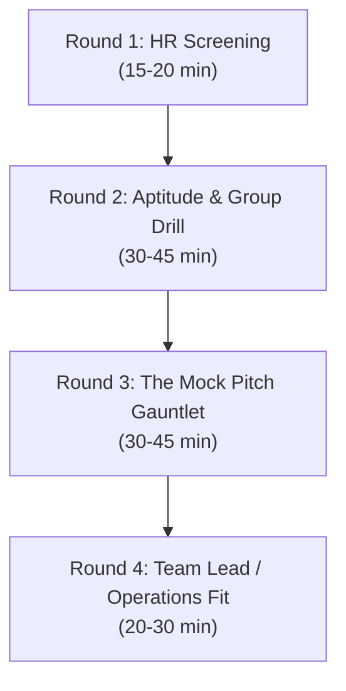

# BHANZU BDA INTERVIEW COMPENDIUM: THE A TO Z MASTER BIBLE
**Target Role:** Business Development Associate (BDA) — Domestic & International (US/UK) Corridors  
**Target Organization:** Bhanzu (Founded by Neelakantha Bhanu Prakash)  
**Location:** HSR Layout, Bengaluru  
**Candidate Profile:** Aditya Mehra | BBA International Business (Dayananda Sagar University '26)  
**Focus:** 100% Comprehensive, Verbatim, Zero-Fluff Interview Mastery

---

## TABLE OF CONTENTS
1. **Module A:** The Deep Corporate & Founder Dossier
2. **Module B:** The 4-Round Interview Pipeline Demystified
3. **Module C:** Aditya Mehra’s Tailored STAR Defense Engine
4. **Module D:** The 25 Core Interview Questions & Word-for-Word Answers
5. **Module E:** The Live Mock Pitch & Roleplay Gauntlet (5 Parent Archetypes)
6. **Module F:** Inside Sales Metrics, Tooling & Daily Life at HSR Layout
7. **Module G:** Telephonic Psychology, Voice Modulation & Pacing
8. **Module H:** Salary Negotiation, Questions for the Panel & Follow-Up Playbook

---

## MODULE A: THE DEEP CORPORATE & FOUNDER DOSSIER

### 1. The Genesis & The Founder
* **The Founder:** **Neelakantha Bhanu Prakash** (born 1999 in Telangana).
* **The Origin Story:** At age 5, Bhanu survived a severe head injury and was bedridden for a year. To keep his brain active and fight cognitive regression, his parents introduced him to mental math puzzles and the abacus. He rapidly advanced to competitive mental arithmetic.
* **World Records:** Broke records held by **Shakuntala Devi** and Scott Flansburg; crowned the *"World's Fastest Human Calculator"*. In 2020, he won India's first-ever Gold Medal at the **Mind Sports Olympiad (London)**.
* **Why He Started Bhanzu (2020):** Bhanu realized that 75%+ of children develop math phobia not because math is hard, but because the traditional schooling system teaches math as a boring, mechanical, formula-memorization subject. He created Bhanzu to prove that math is a language of patterns, music, art, and cognitive reasoning.

### 2. Pedagogy & What Makes Bhanzu Unique
* **Core Philosophy:** *"Math is not about calculation; calculation is merely a byproduct of numerical intuition."*
* **The 4x Speed Claim:** Bhanzu trains students to calculate 4 times faster than school standards through proprietary pattern-recognition algorithms, mental visualization, and storytelling.
* **Experiential Learning:** Teaches fractions through music rhythms, geometry through architectural structures, and algebra through real-world trade and resource sharing.
* **Age Groups:** Targets kids aged 5 to 16 (Kindergarten through Grade 9/10).

### 3. Market Corridors & International Expansion
* **Domestic (India):** Focus on CBSE, ICSE, and state boards where parents are anxious about foundational school scores, Olympiads, and future entrance tests (JEE/NEET foundation).
* **US Corridor:** Common Core State Standards alignment, building STEM readiness, confidence in standardized tests (SAT/ACT early math foundations), eliminating reliance on calculators.
* **UK Corridor:** Key Stage 1, 2, and 3 curriculum, preparation for 11+ exams, GCSE foundations, and fostering independent problem-solving skills.
* **Middle East & Southeast Asia:** Strong expatriate (Indian, Pakistani, British) and local parent bases aiming for international school curriculum mastery.

### 4. Financials, Investors & Scale
* **Funding:** Total raised **\$33.5M+**.
  * Seed (\$2M, 2021): Lightspeed Venture Partners.
  * Series A (\$15M, 2022): Eight Roads Ventures, B Capital, Lightspeed.
  * Series B (\$16.5M, late 2024): Epiq Capital, Z3Partners, Lightspeed.
* **Valuation:** ~$100M – \$130M.
* **Bangalore Presence:** Prime operations in **HSR Layout**, the epicentre of Indian tech and inside sales operations.

---

## MODULE B: THE 4-ROUND INTERVIEW PIPELINE DEMYSTIFIED



### Round 1: HR Screening (Elimination Filter)
* **What they test:** Communication hygiene, voice clarity, energy, shift flexibility (US/UK night shifts require high stamina), willingness to work from HSR Layout office, and salary realism.
* **Red Flags that eliminate candidates:** Sluggish tone, mumbling, complaining about cold calling, reluctance to work 6-day weeks or night shifts.

### Round 2: Sales Aptitude & Group Activity
* **What they test:** Extroversion, active listening, structured thinking, commercial instincts, and how you articulate arguments under time pressure.
* **Common Topics:** *"Is online learning better than offline tuitions?"*, *"Sell this unconventional product"*, or *"Debate: Price vs. Value in Education"*.

### Round 3: The Live Mock Pitch & Roleplay (The Critical Round)
* **What they test:** The interviewer roleplays a difficult, skeptical parent. They will interrupt, act bored, claim the price is too high, or say their child doesn't need math.
* **What wins the round:** Empathy, diagnostic questions, refusing to argue, reframing cost into value, and confidently closing for a demo slot.

### Round 4: Team Lead & Operations Round
* **What they test:** Grit, quota mentality, response to targets, how you react to being scolded or facing a string of 30 rejections, and long-term career ambition.

---

## MODULE C: ADITYA MEHRA’S TAILORED STAR DEFENSE ENGINE

Every answer you give must be grounded in your authentic experiences to ensure zero hesitation and high conviction:

| Real Experience Anchor | Core Competency | How It Translates to Bhanzu BDA |
| :--- | :--- | :--- |
| **Pencil Mark Interior Solutions** | Outbound B2B Outreach & Discovery Calls | Cold prospecting stamina, identifying decision-makers, setting qualification criteria, pitching high-value solutions. |
| **AERO India 2025 (Yelahanka AFB)** | High-Stakes Public Pitching & Lead Capture | Approaching total strangers, immediate rapport building, pitching under intense noise and fast-paced footfall. |
| **Instawork Services India** | Client Deliverable & Operational QA | Process discipline, CRM hygiene, tracking funnel metrics, zero data errors. |
| **Family Retail & Food Business** | Customer Relationship & Cash Flow | Upselling, repeat customer retention, commercial empathy, handling price objections daily. |
| **BBA International Business (DSU)** | Cross-Border Consumer Psychology | Understanding overseas client communication (US/UK corridors), cultural sensitivity, consultative selling. |

---

## MODULE D: THE 25 CORE INTERVIEW QUESTIONS & WORD-FOR-WORD ANSWERS

### 1. "Walk me through your resume."
> *"I am an International Business graduate from Dayananda Sagar University with a direct grounding in high-velocity commercial outreach and client engagement.*  
> *Rather than remaining in theoretical marketing classes, I tested my skills in the field. At Pencil Mark Interior Solutions, I spearheaded cold outbound corporate outreach across Bengaluru tech parks, conducting discovery calls with decision-makers and qualifying high-intent leads for commercial proposals.*  
> *I also represented commercial operations on-ground at AERO India 2025 at Yelahanka Air Force Station, pitching to international trade delegates and capturing high volumes of qualified visitor leads under intense pressure.*  
> *I love the energy of high-quota environments, consultative selling, and helping customers realize immediate value. That is why I am here: to join Bhanzu’s front-line business development team and drive international enrollments."*

### 2. "Why do you want to join Bhanzu over Byju's or other legacy EdTechs?"
> *"Legacy EdTech companies struggled because they sold a commoditized product — pre-recorded video tablets pushed through aggressive, predatory financing. Parents felt cheated.*  
> *Bhanzu is fundamentally different. It is built on a transformative pedagogical foundation created by Neelakantha Bhanu Prakash, the world's fastest human calculator. We are not selling exam cramming; we are curing math phobia through visual, experiential cognitive frameworks.*  
> *Backed by top-tier venture firms like Epiq Capital and Eight Roads, Bhanzu is in a hyper-growth phase, especially across North America and the UK. I want to build my career in a company where I can stand 100% behind the value of the product on every single call."*

### 3. "Why should a BBA graduate do sales instead of HR, Finance, or Marketing?"
> *"Because sales is the heartbeat of every enterprise. In International Business, you learn that without revenue and customer acquisition, strategy and finance have nothing to manage.*  
> *Sales is also completely meritocratic. In most corporate roles, recognition is subjective. In sales, the dashboard speaks for itself: if you work harder, sharpen your pitch, and close deals, your growth is fast and undeniable. I want my output to determine my success."*

### 4. "What is sales according to you?"
> *"Sales is not about manipulating or pressuring someone into buying something they don't want. Sales is **consultative problem-solving**.*  
> *It begins with asking deep, diagnostic questions to uncover an unspoken pain point — like a parent secretly worrying that their child will fall behind in school. Once that pain is diagnosed, sales is simply bridging the gap between their current reality and their desired future with the right solution."*

### 5. "What motivates you to pick up the phone 100 times every single day?"
> *"Two things:*  
> *First, **Pipeline Discipline**: In outbound sales, every single dial is a mathematical probability. Dial 80 might be an uninterested parent, but dial 81 could be a mother in California desperately searching for a math mentor for her 4th-grade son.*  
> *Second, **Financial & Career Growth**: I am deeply driven by targets and incentives. Knowing that hitting my daily numbers directly builds my quarterly commissions and accelerates my promotion to Team Lead keeps my energy at peak level from 9 AM to 9 PM."*

### 6. "How do you handle a day where you make 90 calls and get zero connects or 20 rejections?"
> *"I do not let a bad hour turn into a bad day.*  
> *First, I conduct a 60-second pitch check: Am I sounding energetic and consultative, or am I sounding like a scripted robot? Did I give the parent room to talk, or did I vomit features?*  
> *Second, I remind myself of the law of averages. In sales, every 'No' brings you statistically closer to a 'Yes'. At Pencil Mark and on-ground brand activations, I learned that customer rejections are never personal. I take a sip of water, reset my posture, smile, and dial call number 91 with the same enthusiasm as call number 1."*

### 7. "What if your Team Lead criticizes your performance publicly in the evening meeting?"
> *"I take feedback objectively, not emotionally.*  
> *If my Team Lead calls out my numbers, it’s because targets are non-negotiable in business development. Instead of getting defensive, I would write down the specific gaps — whether it's low talk-time, poor pitch objection handling, or low demo show-ups.*  
> *After the meeting, I would approach the Team Lead and say: 'I hear you, and my numbers today were below our standard. Could you listen to two of my call recordings from today and tell me the exact spot where I lost the parent?' Then I will stay an extra hour to fix it."*

### 8. "What are your greatest strength and your biggest weakness?"
> * **Strength:** *"Resilience and consultative empathy. I connect easily with strangers, listen carefully without interrupting, and don't get flustered by skepticism or harsh tones."*  
> * **Weakness:** *"In my early outreach experience at Pencil Mark, I sometimes spent too much time trying to convince an obviously unqualified lead because I didn't want to give up on them. I’ve since learned the discipline of qualification: spend 80% of your energy on high-intent, qualified prospects and politely disqualify tire-kickers early to protect pipeline velocity."*

### 9. "Tell me about a time you turned a 'NO' into a 'YES'."
> *"During our commercial partnership outreach for our university's flagship cultural festival, I approached a local premium electronics retailer for title sponsorship.*  
> *The store manager immediately rejected us, saying: 'We spent money on student fests last year and got zero footfall; it’s a waste of our marketing budget.'*  
> *Instead of pushing the sponsorship brochure, I stopped and asked: 'What is your primary commercial goal this month?' He mentioned they had an excess inventory of noise-canceling headphones that weren't moving.*  
> *I restructured our proposal: rather than just placing a banner, we created an interactive 'Silent DJ Booth' at the concert entrance where students had to use his exact headphones to enter a contest, driving direct product demos. He signed a ₹40,000 sponsorship on the spot. In sales, you don't push what you have; you package what they need."*

### 10. "Sell me this pen / water bottle / mobile case."
*(The classic sales test. Never start describing features! Always diagnose first.)*
> **Script:**  
> *"Before I tell you anything about this pen, sir, may I ask: how often do you sign contracts or write down strategic notes during your day? ... When was the last time you reached for a pen during an important client closing and found it was scratching or leaking ink on your document? ...*  
> *This pen isn't just about ink on paper; it's engineered with zero-friction tungsten carbide ball technology, ensuring that when you hand it to an executive to sign a multi-lakh contract, it feels weighted, effortless, and premium. Sign this trial sheet right now and feel the difference. Shall I pack two of these for your desk?"*

### 11. "Are you prepared for US / UK night shifts and 6-day work weeks at HSR Layout?"
> *"Yes, 100%. I specifically targeted Bhanzu’s international sales corridor because of the higher ticket size, the exposure to global consumer behavior, and the faster earning potential.*  
> *I live in Bengaluru, have reliable personal transit, and have deliberately organized my sleep and routine for evening/night shifts. High-growth sales requires intensity, and I am ready to commit fully."*

### 12. "What do you know about our pricing and courses?"
> *"Bhanzu offers comprehensive, multi-month cognitive math curriculums divided into cohorts based on age and grade level (Ages 5–16).*  
> *Courses typically span 3-month foundational modules, 6-month accelerators, and 1-year transformation programs. Program fees in India range between ₹25,000 and ₹55,000+ depending on cohort depth, while international US/UK programs are priced between \$800 and \$2,200+. Our sales cycle relies on booking parents into a high-impact, 45-minute live diagnostic demo class with an expert mentor, where the curriculum is tailored and closed."*

### 13. "What would you do if a parent is angry and starts yelling at you for calling?"
> *"I use the **De-escalation Law**: lower my volume, soften my tone, and validate their emotion.*  
> *I would say: 'I completely hear your frustration, and I sincerely apologize if this call interrupted an important moment for you. We only reached out because someone registered Aryan's details on our math portal. I will immediately update our records so you aren't disturbed again. Have a wonderful evening.'*  
> *Often, when you respond with genuine politeness rather than defensiveness, the parent softens and says: 'Well, what was this about anyway?' If not, you respect their boundary and move to the next lead."*

### 14. "What if your monthly target is 10 admissions, and on the 20th of the month you only have 3?"
> *"I treat the 20th as a crisis point, not a surrender point.*  
> *I would take three immediate actions:*  
> *1. **Pipeline Scrub:** Re-engage all 'warm' leads from the past 45 days who attended a demo but didn't close due to timing or hesitation. Pitch them a month-end scholarship or cohort start date.*  
> *2. **Increase Funnel Input:** Increase my daily dials from 90 to 130 to book double the demos for the upcoming weekend.*  
> *3. **Show-Up Hygiene:** Personally call and WhatsApp every booked parent 2 hours before the demo with an engaging video of Bhanu Prakash to ensure an 85%+ attendance rate.*  
> *Sales is about momentum; you can turn an entire month around in 72 hours of intense execution."*

### 15. "Where do you see yourself in 2 years?"
> *"In 2 years, I see myself as a Senior BDA or Team Lead at Bhanzu, mentoring a pod of 8–10 junior associates.*  
> *I want to master the consultative sales cycle across both Indian and Western corridors, become one of the top 5% revenue producers, and take on operational responsibilities in sales training and international account scaling."*

---

## MODULE E: THE LIVE MOCK PITCH & ROLEPLAY GAUNTLET

During Round 3, the interviewer will say:  
*"I am Mrs. Jessica Miller from Dallas, Texas. My son Noah is 9 years old in 4th grade. You have 3 minutes to pitch me and book a demo."*

```
[THE 5 PHASES OF THE CALL]
1. Pattern Interrupt & Permission  --> 2. Diagnostic Pain Discovery
3. Emotional Agitation             --> 4. The Bhanzu Solution Hook
5. The Dual-Choice Booking Close
```

### Archetype 1: The "Too Busy / Cut the Call" Parent
* **Parent:** *"I’m at work right now, I don't have time for sales calls. Send me an email."*
* **Candidate Defense:**
  > *"Completely understand, Mrs. Miller! I know you're in the middle of a busy workday.*  
  > *I won't take your time now. I’m only calling because Noah’s math profile came up on our early STEM assessment queue.*  
  > *I will drop the overview directly to your email, but can I give you a quick 2-minute call today at 7:30 PM after dinner, or would 8:15 PM be more convenient?"*

---

### Archetype 2: The "My Child is Already a Topper" Parent
* **Parent:** *"Noah is already getting straight A's in school math. We don't need tutoring."*
* **Candidate Defense:**
  > *"That’s incredible to hear, Mrs. Miller, and you must be very proud of Noah's focus!*  
  > *Here is the reality we see across thousands of top students: 4th-grade school math tests whether a child can remember the teacher's steps. But when Noah moves into middle school, algebra, and future standardized tests like the SAT or competitive math leagues, memory stops working — it demands **numerical intuition, cognitive agility, and speed**.*  
  > *Bhanzu was founded by Neelakantha Bhanu, the world's fastest human calculator. We don't teach remedial tuition for struggling kids; we are an acceleration program for bright minds.*  
  > *Let’s have Noah take our 45-minute live diagnostic session this weekend. If he breezes through our mental calculation puzzles, you’ll have independent confirmation of his genius. If there are hidden calculation bottlenecks, you'll know early. We have slots this Saturday at 11 AM or Sunday at 3 PM Dallas time. Which works best?"*

---

### Archetype 3: The "EdTech Trauma" Parent (Burned by Byju's/Outsourced Programs)
* **Parent:** *"We tried online classes with another company last year. It was terrible — recorded videos, zero teacher interaction, and a total waste of money."*
* **Candidate Defense:**
  > *"Mrs. Miller, I completely understand your frustration, and honestly, a lot of parents tell us that exact story. The previous wave of online programs simply sold video subscriptions where kids stared at an iPad with zero engagement.*  
  > *Bhanzu is fundamentally different in three ways:*  
  > *1. **Live, Small-Group Mentoring:** Every session is live with a trained math specialist who interacts directly with Noah on every calculation.*  
  > *2. **Storytelling & Visual Algorithms:** We don't make him do 100 repetitive worksheet problems; we teach mental shortcuts that allow him to solve math in his head 4 times faster.*  
  > *3. **Measurable Diagnostic Benchmarks:** You get detailed speed and accuracy reports every 4 weeks.*  
  > *You don't need to commit to any program today. Attend our complimentary 45-minute live interactive session this weekend. Sit right next to Noah. If it feels anything like your previous experience, you can reject us on the spot. But give Noah the chance to experience what real math learning feels like."*

---

### Archetype 4: The "Price Objection" Parent
* **Parent:** *"Your courses are way too expensive. I can hire a local high school tutor for half that price."*
* **Candidate Defense:**
  > *"I completely appreciate your focus on budget, Mrs. Miller. Every dollar you invest in Noah’s education must show clear return.*  
  > *A local tutor will sit with Noah and help him finish tomorrow’s homework, but next week when the homework changes, the struggle returns. The tutor is treating the symptom; Bhanzu cures the disease.*  
  > *Bhanzu rewires Noah’s brain to understand numerical logic, mental estimation, and problem-solving patterns. Once his mental speed increases by 4x, he won't need a tutor for middle school, high school, or college entrance tests.*  
  > *Before we even talk about costs, the diagnostic session this weekend is 100% free. Experience the change in Noah’s excitement first. Shall we lock in Saturday at 11:00 AM Dallas time?"*

---

### Archetype 5: The "Let Me Talk to My Husband / Let Me Think About It" Parent
* **Parent:** *"It sounds interesting, but I need to talk to my husband first before booking anything."*
* **Candidate Defense:**
  > *"That is 100% the right approach, Mrs. Miller. Educational decisions for Noah should always be made jointly.*  
  > *However, if you explain Bhanzu to your husband tonight, you’ll have to summarize our algorithms, cognitive speed metrics, and visual pedagogy over dinner, which is really hard to convey second-hand.*  
  > *The easiest way is for both of you to attend the 45-minute live session together with Noah this weekend. You can watch him play the interactive number games, see how the mentor works with him, and make the decision together right after.*  
  > *Would Saturday at 11:00 AM or Sunday at 3:00 PM be a time when both you and your husband are free?"*

---

## MODULE F: INSIDE SALES METRICS, TOOLING & DAILY LIFE AT HSR LAYOUT

### 1. A Day in the Life of a Bhanzu BDA (US Shift / 6:30 PM to 3:30 AM IST)
* **6:30 PM – 7:00 PM:** Arrival at HSR Layout office, tea, daily sales huddle with Team Lead, review of target quotas.
* **7:00 PM – 9:00 PM:** Pipeline scrubbing, logging into CRM (LeadSquared / Salesforce), reviewing notes on warm prospects, sending WhatsApp/Email reminders for today’s demos.
* **9:00 PM – 12:30 AM (US Morning/Noon):** **Dialing Block 1 (Fresh Leads)** — 50+ cold and warm dials, diagnostic pitches, booking upcoming weekend slots.
* **12:30 AM – 1:15 AM:** Dinner break with pod members.
* **1:15 AM – 3:00 AM (US Afternoon/Evening):** **Dialing Block 2 (Closing Calls)** — Connecting with parents who completed their demo classes earlier today, conducting consultative closing pitches, handling pricing, processing credit card payments.
* **3:00 AM – 3:30 AM:** Daily MIS update, updating CRM statuses (`Demo Booked`, `Demo Completed`, `Payment Link Sent`, `Enrolled`), Team Lead sign-off.

### 2. Key Metrics Every BDA Must Track
* **Dials:** 80 to 120 calls per shift.
* **Talk Time:** Minimum 2.5 to 3.5 hours per shift.
* **Connect Rate:** ~15% to 25% of dials result in a conversation.
* **Demos Booked:** 3 to 5 qualified demos booked per day.
* **Show-up Rate:** 65% to 75%+ of booked parents attend the demo.
* **Closing Conversion:** 15% to 25% of attended demos convert into paid enrollments.

---

## MODULE G: TELEPHONIC PSYCHOLOGY, VOICE MODULATION & PACING

1. **The 'Mirroring & Labeling' Technique:**
   * If a parent says: *"Math gives my daughter severe stress before tests."*
   * **Mirror:** *"Severe stress before tests?"* (Repeat the last 3-4 words as a question. They will open up and elaborate on their pain).
   * **Label:** *"It sounds like she is putting in hard work, but the exam pressure is masking her true potential."*
2. **The 3 Vocal Micro-Tones:**
   * **Curious Friend:** Used in the first 30 seconds (*"Hi, is this Mrs. Miller? Hi, I’m calling regarding Noah’s math quiz..."*).
   * **Empathetic Expert:** Used during discovery (*"I understand, math anxiety is so common at age 9 because schools teach memorization rather than logic..."*).
   * **Confident Closer:** Used when booking the slot (*"I have two slots remaining with our senior mentor: Saturday at 11 AM or Sunday at 3 PM. Let’s secure Saturday for you."*).
3. **The Power of the Smile:**
   * Always sit upright and smile while speaking. The physical act of smiling changes the shape of your vocal cords, making your tone warm, friendly, and non-threatening over the phone.

---

## MODULE H: SALARY NEGOTIATION, PANEL QUESTIONS & FOLLOW-UP PLAYBOOK

### 1. Handling the Salary Question
* **Interviewer:** *"What are your CTC expectations?"*
* **Your Answer:**  
  > *"My research indicates that the standard package for an entry-level BDA at Bhanzu is between ₹6 LPA and ₹8 LPA, typically structured as ₹4.5L to ₹5.5L fixed plus performance incentives.*  
  > *Given my hands-on background in B2B corporate outreach at Pencil Mark and commercial pitching at AERO India, I know I will ramp up quickly and contribute to revenue from week one.*  
  > *However, my primary priority is joining the right sales pod, proving my performance on the dashboard, and earning top-bracket incentives. I am comfortable with company standards for high performers."*

### 2. The 3 Killer Questions to Ask at the End of the Interview
1. *"For a new BDA joining this pod, what specific trait separates someone who achieves 150% of their target in their second month from someone who misses their quota?"*
2. *"With Bhanzu’s Series B expansion into the US and UK markets, what is the biggest cultural adjustment Indian associates usually have to make when speaking to overseas parents?"*
3. *"How does the weekly pitch feedback loop work here? How often do Team Leads review recorded calls to help associates sharpen objection handling?"*

### 3. Post-Interview Follow-Up Note (To send via LinkedIn/Email within 3 hours)
> **Subject:** Thank You — Aditya Mehra | Interview for Business Development Associate  
>  
> *"Dear [Interviewer's Name],*  
>  
> *Thank you for the insightful conversation today regarding the BDA role at Bhanzu.*  
>  
> *I thoroughly enjoyed our discussion on consultative selling, handling parent objections, and scaling Bhanzu’s international math cohorts. Our conversation reaffirmed my strong conviction in Bhanzu’s mission to eradicate math phobia through visual, experiential learning.*  
>  
> *Given my outbound outreach experience at Pencil Mark and commercial engagement at AERO India 2025, I am eager to bring high call stamina, consultative discipline, and target focus to your sales pod at HSR Layout.*  
>  
> *Looking forward to the next steps!*  
>  
> *Warm regards,*  
> **Aditya Mehra**  
> *+91 7003456624 | Bengaluru"*
