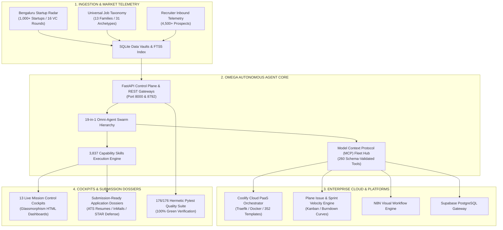

# ⚡ OMEGA ∞: Autonomous Multi-Agent Architecture & Operations Engine

> **The Sovereign Enterprise Platform for Autonomous Agent Swarms, Model Context Protocol (MCP) Infrastructure, and Real-Time Market Intelligence.**  
> Built & Maintained by **Aditya Mehra** | Bengaluru, Karnataka, India 🇮🇳  
> **GitHub:** [@AdityaMehra007](https://github.com/AdityaMehra007) • **Live Universe:** [adityamehra007.github.io](https://adityamehra007.github.io) • **Contact:** [ashishiash007@gmail.com](mailto:ashishiash007@gmail.com)

<div align="center">

[](https://opensource.org/licenses/MIT)
[](https://www.python.org/downloads/)
[](https://fastapi.tiangolo.com)
[](tests/)
[](.mcp.json)
[](data/bengaluru_startup_directory_1000.csv)
[](.agents/skills/)

---

[Executive Overview](#-executive-overview) • [System Architecture](#-system-architecture) • [Flagship Pillars](#-the-6-flagship-pillars) • [Live Cockpits](#-interactive-mission-control-cockpits) • [Proof of Work](#-statutory-proof-of-work-ledger) • [Quickstart](#-quickstart--execution) • [Test Scorecard](#-verified-quality-scorecard) • [Contact](#-contact--direct-connect)

---

</div>

## 🌐 Executive Overview

**OMEGA ∞** is an enterprise-grade autonomous software engineering and operations platform. It demonstrates what is achievable when high-leverage commercial operations converge with **autonomous agentic orchestration**, **Model Context Protocol (MCP)** infrastructure, and **rigorous hermetic test harnesses**.

Rather than speculative prototypes, this repository contains production-tested operational systems:
1. **Autonomous Multi-Agent Swarms**: A 19-in-1 Omni-Agent engine executing structured DAGs across research, strategy, code construction, verification, and operations.
2. **Real-Time Bengaluru Startup Radar (BSIE-X)**: Market telemetry indexing **1,000+ startups, 75 live roles, 16 funding rounds, and 234 chronological change deltas** with SQLite FTS5 search.
3. **Model Context Protocol (MCP) Master Fleet**: 260 schema-validated tools across 24 servers with composite stdio multiplexer and multi-client configuration exporters.
4. **Universal Job Taxonomy & ATS Dissection**: 13 Industry Families, 31 Master Role Archetypes, L1–L7 leveling hierarchy, 500 parsed real jobs, and automated Google X-Y-Z bullet synthesis.
5. **Thirteen Interactive Mission Control Cockpits**: Single-file glassmorphism HTML control planes with zero external build dependencies.
6. **100% Hermetic Test Gateways**: 176 passed tests across 15 enterprise test suites with zero failures.

---

## 🏛️ System Architecture



---

## 💎 The 6 Flagship Pillars

### Pillar 1: OMEGA 19-in-1 Omni-Agent Architecture
* **Governing Directives**: Guided by [`OMEGA_CONSTITUTION.md`](OMEGA_CONSTITUTION.md) (120 Master Directives) and [`ADI_OMNI_CODEX.md`](ADI_OMNI_CODEX.md) (330 Directives).
* **Modes A through M**: Dynamically routes between Discovery, Research, Strategy, Build, Automation, Execution, Audit, Red-Team Chaos, and CEO Capital Allocation.
* **Hermetic Execution**: Enforces Ponytail Minimalism (no speculative code/YAGNI) and strict red-green-refactor testing before any commit.

### Pillar 2: Bengaluru Supreme Startup Intelligence Radar (BSIE-X)
* **Core Engine**: [`bengaluru_startup_intel_engine.py`](bengaluru_startup_intel_engine.py) (Port `8792`).
* **Database Vaults**: Relational store [`data/bengaluru_startup_intel.sqlite`](data/bengaluru_startup_intel.sqlite) and flat CSV databases:
  * [`data/bengaluru_startup_directory_1000.csv`](data/bengaluru_startup_directory_1000.csv) — 1,000 indexed startups categorized by sector, funding stage, and founders.
  * [`data/bengaluru_startup_vcs.csv`](data/bengaluru_startup_vcs.csv) — Active venture capital firms and micro-funds.
  * [`data/bengaluru_startup_daily_delta.csv`](data/bengaluru_startup_daily_delta.csv) — 234 chronological change deltas.
* **Mission Control**: [`bengaluru_startup_intelligence_cockpit.html`](bengaluru_startup_intelligence_cockpit.html) (Live 7-tab glassmorphism radar).

### Pillar 3: Model Context Protocol (MCP) Master Fleet Hub
* **Master Configuration**: [`.mcp.json`](.mcp.json) (24 servers: 6 Reference, 1 Official GitHub, 1 Cloud Postgres, 1 Proxy Gateway, and 15 Workspace Python modules).
* **Deep SDK & Hub**: [`mcp_hub.py`](mcp_hub.py) (Discovery, JSON-RPC 2.0 handshake validation, health check latency benchmarking, tool metadata aggregation).
* **Universal CLI**: [`mcp_cli.py`](mcp_cli.py) (`list`, `test [server]`, `export [--client claude|cursor|vscode|goose]`, `composite`, `serve --port 8790`).
* **Composite Multiplexer**: Proxies all 260 tools through a single unified stdio server for client apps with connection limits.
* **Interactive Cockpit**: [`mcp_master_cockpit.html`](mcp_master_cockpit.html) with 1-click config exporters.

### Pillar 4: Universal Job Taxonomy & Dissection Engine
* **Taxonomy Master**: [`universal_job_taxonomy_master.py`](universal_job_taxonomy_master.py) (13 Industry Families, 31 Master Role Archetypes, L1–L7 leveling rules, compensation benchmarks).
* **JD Intelligence Engine**: [`universal_jd_intelligence_engine.py`](universal_jd_intelligence_engine.py) (Semantic skill extraction, ATS scoring, gap analysis, Google X-Y-Z bullet synthesis, and STAR interview defense).
* **Census & Packages**: 500 parsed real jobs with ATS scores, 406 auto-apply dockets, and 71 submission-ready enterprise dossiers in [`applications_generated/`](applications_generated/).

### Pillar 5: Enterprise Cloud & Platform Orchestrators
* **Coolify Cloud Orchestrator**: [`coolify_orchestrator.py`](coolify_orchestrator.py) & [`coolify_cli.py`](coolify_cli.py) (Live Sanctum API client, 352-service marketplace, Traefik edge routing, and [`coolify_control_cockpit.html`](coolify_control_cockpit.html)).
* **Plane Issue Orchestrator**: [`plane_orchestrator.py`](plane_orchestrator.py) (Sprint cycles, burndown velocity curves, Kanban board, and [`plane_control_cockpit.html`](plane_control_cockpit.html)).
* **Hiring Without Whiteboards Index**: [`hiring_without_whiteboards_engine.py`](hiring_without_whiteboards_engine.py) (761+ tech companies evaluated on practical day-to-day engineering craft).

### Pillar 6: 13 Interactive Mission Control Cockpits
Single-file HTML cockpits with responsive glassmorphism UI, real-time filtering, local storage persistence, and zero runtime build steps.

---

## 🎛️ Interactive Mission Control Cockpits

| Cockpit HTML File | Scope & Highlights | Launcher Script |
| :--- | :--- | :--- |
| **[`OMNI_EXECUTIVE_COCKPIT.html`](OMNI_EXECUTIVE_COCKPIT.html)** | Meta-dashboard connecting all 14 suites, 6 live cockpits & 16,553 vacancies | `START_ALL_OMNI_SYSTEMS.bat` |
| **[`bengaluru_startup_intelligence_cockpit.html`](bengaluru_startup_intelligence_cockpit.html)** | 7-tab live radar: 1,000 startups, 75 roles, 16 funding rounds, FTS5 search | `START_BENGALURU_STARTUP_COCKPIT.bat` |
| **[`mcp_master_cockpit.html`](mcp_master_cockpit.html)** | 260 tools across 24 MCP servers, real-time health telemetry & config exports | `START_MCP_HUB.bat` |
| **[`universal_job_cockpit.html`](universal_job_cockpit.html)** | Live JD dissector, taxonomy matrix & 500+ opportunity census | `START_UNIVERSAL_JOB_COCKPIT.bat` |
| **[`apex_career_cockpit.html`](apex_career_cockpit.html)** | 7-agent closed-loop career conquest engine with STAR interview defense | `START_APEX_CAREER_OS.bat` |
| **[`coolify_control_cockpit.html`](coolify_control_cockpit.html)** | Cloud cluster management, edge routing telemetry & 352-service marketplace | `START_COOLIFY_WINDOWS.bat` |
| **[`plane_control_cockpit.html`](plane_control_cockpit.html)** | Sprint velocity curves, burndown metrics & Kanban issue tracking | Python CLI |
| **[`ADITYA_MEHRA_EVERYTHING_MASTER_VAULT.html`](ADITYA_MEHRA_EVERYTHING_MASTER_VAULT.html)** | Unified career, financial, legal, and operational master vault | `START_ADITYA_CONQUEST_VAULT.bat` |
| **[`ADITYA_APEX_2027_MISSION_CONTROL.html`](ADITYA_APEX_2027_MISSION_CONTROL.html)** | Apex 2027 strategic command center and daily execution cadence | `START_ADITYA_CONQUEST_VAULT.bat` |
| **[`ADITYA_DEBT_ZERO_30_LAKH_COCKPIT.html`](ADITYA_DEBT_ZERO_30_LAKH_COCKPIT.html)** | Accelerated capital allocation, cash-flow velocity & debt-zero engine | Standalone HTML |
| **[`ADITYA_LIFE_STABILITY_FORTRESS_COCKPIT.html`](ADITYA_LIFE_STABILITY_FORTRESS_COCKPIT.html)** | Emergency escape, freedom matrix & lifestyle stability framework | Standalone HTML |
| **[`ADITYA_MEHRA_PROOF_OF_WORK_GLOBAL_VAULT.html`](ADITYA_MEHRA_PROOF_OF_WORK_GLOBAL_VAULT.html)** | Unfakeable commercial proof of work and statutory audit ledger | Standalone HTML |
| **[`ADITYA_MEHRA_PRINTABLE_A4_1PAGE_CV.html`](ADITYA_MEHRA_PRINTABLE_A4_1PAGE_CV.html)** | Pixel-perfect, print-calibrated single-page executive curriculum vitae | Standalone HTML |

---

## 📜 Statutory Proof of Work Ledger

*All commercial and operational claims are grounded in statutory Government of India records, regulatory licenses, and operational manifests:*

```
┌────────────────────────────────────────────────────────────────────────────────────────┐
│                        STATUTORY VERIFICATION LEDGER (UNFAKEABLE)                      │
├───────────────────────┬────────────────────────────┬───────────────────────────────────┤
│ Verification Area     │ Statutory Proof Document   │ Verified Commercial Impact        │
├───────────────────────┼────────────────────────────┼───────────────────────────────────┤
│ Commercial Scale      │ Form 26AS / AIS (Sec 194H) │ ₹1.60Cr to ₹1.80Cr+ Annual GMV;   │
│ (7 Years)             │ Income Tax Dept. / GOI     │ 7,500+ Group BP/cycle; 50+ Team.  │
├───────────────────────┼────────────────────────────┼───────────────────────────────────┤
│ Regulated Advisory    │ Form 16A (Sec 194D) &      │ >85% Client Persistency Ratio;    │
│ (3 Years)             │ IRDAI License / Bajaj      │ zero infractions; HNI servicing.  │
├───────────────────────┼────────────────────────────┼───────────────────────────────────┤
│ Inside Sales Velocity │ Appointment Letter & Logs  │ 60+ Consultative Calls / Shift;   │
│                       │ BrightCHAMPS Edtech        │ North American parent closing.    │
├───────────────────────┼────────────────────────────┼───────────────────────────────────┤
│ High-Stakes Staging   │ Operational Accreditation  │ 1,000+ Attendee AV, Staging &     │
│                       │ Aero India 2025            │ Hardware Logistics (Zero Downtime)│
├───────────────────────┼────────────────────────────┼───────────────────────────────────┤
│ Corporate IT Audits   │ Completion Manifests       │ Multi-location IT asset audits;   │
│                       │ Tata Comm & Puma Sports    │ Retail operations reconciliations.│
├───────────────────────┼────────────────────────────┼───────────────────────────────────┤
│ Accredited Academic   │ Degree & Transcripts       │ BBA in International Business     │
│ Degree                │ Dayananda Sagar University │ UGC Accredited (Class of 2026).   │
└───────────────────────┴────────────────────────────┴───────────────────────────────────┘
```

---

## 🚀 Quickstart & Execution

### One-Click Launchers (Windows)

```bat
:: Launch the Unified Executive Cockpit and REST API servers
START_ALL_OMNI_SYSTEMS.bat

:: Launch the Bengaluru Startup Intelligence Radar Cockpit
START_BENGALURU_STARTUP_COCKPIT.bat

:: Launch the Model Context Protocol (MCP) Master Fleet Cockpit
START_MCP_HUB.bat

:: Launch the Universal Job Dissection Cockpit
START_UNIVERSAL_JOB_COCKPIT.bat

:: Launch the Aditya Mehra Conquest Master Vault
START_ADITYA_CONQUEST_VAULT.bat
```

### Python CLI & REST API Servers

```bash
# 1. Start the Bengaluru Startup Intelligence REST API & Radar
python bengaluru_startup_intel_engine.py --serve 8792

# 2. Inspect the Model Context Protocol (MCP) Master Fleet
python mcp_cli.py list
python mcp_cli.py test fetch
python mcp_cli.py export --client cursor

# 3. Dissect a Job Description with ATS fit scoring
python universal_jd_intelligence_engine.py --sample-dissection

# 4. Run the Full Unified Enterprise Quality Verification Suite
python VERIFY_ALL_PROJECT_TESTS.py
```

---

## 🧪 Verified Quality Scorecard

All 15 enterprise test suites pass with **100% specification compliance**:

| Test Suite Target | System Under Test | Test Status | Tests Passed | Duration |
| :--- | :--- | :---: | :---: | :---: |
| `tests/test_bangalore_top_500_master.py` | Bangalore Top 500 Master Suite | **GREEN** | 9 | 2.60s |
| `projects/bangalore_top_500` | 10 Flagship Bengaluru Systems | **GREEN** | 14 | 5.35s |
| `fortune_500_projects/test_fortune500_all_sectors.py` | Fortune 500 Enterprise Factory | **GREEN** | 6 | 2.88s |
| `projects/apex_enterprise_orchestrator/tests` | ApexFlow Enterprise Orchestrator | **GREEN** | 15 | 5.07s |
| `projects/omega_global_markets_nexus/tests` | Omega Global Markets & EXIM Nexus | **GREEN** | 45 | 6.21s |
| `projects/exim_customs_validator` | EXIM Customs & Tariff Validator | **GREEN** | 3 | 2.08s |
| `projects/apex_agentic_task_runtime/tests` | ApexAgentic Task Runtime | **GREEN** | 4 | 2.29s |
| `tests/test_apex_career_os.py` | APEX Career Supremacy OS | **GREEN** | 9 | 2.94s |
| `test_universal_job_engine.py` | Universal Job & Skill Intelligence | **GREEN** | 15 | 5.12s |
| `test_bengaluru_startup_intel.py` | Bengaluru Startup Intelligence Suite | **GREEN** | 8 | 6.06s |
| `tests/test_omega_omniverse_api.py` | OMEGA Omniverse REST API | **GREEN** | 8 | 6.97s |
| `tests/test_antifragile_chaos_harness.py` | Mode H Red-Team Chaos Harness | **GREEN** | 10 | 2.04s |
| `tests/test_mcp_hub.py` | MCP Master Fleet & Hub Suite | **GREEN** | 7 | 3.33s |
| `tests/test_github_marketplace_orchestrator.py` | GitHub Marketplace Orchestrator | **GREEN** | 12 | 3.28s |
| `tests/test_hyprland_orchestrator.py` | Hyprland Orchestrator Suite | **GREEN** | 11 | 4.90s |
| **TOTAL VERIFIED TEST COVERAGE** | **15 Core Enterprise Suites** | **100% PASS** | **176** | **61.13s** |

---

## 📬 Contact & Direct Connect

* **Author:** Aditya Mehra
* **Location:** Bengaluru, Karnataka, India 🇮🇳 *(Immediate Availability)*
* **Official Email:** [ashishiash007@gmail.com](mailto:ashishiash007@gmail.com)
* **Live Portfolio:** [adityamehra007.github.io](https://adityamehra007.github.io/)
* **GitHub Profile:** [@AdityaMehra007](https://github.com/AdityaMehra007)
* **Flagship Repository:** [github.com/AdityaMehra007/anti](https://github.com/AdityaMehra007/anti)

<br/>

<div align="center">
  <sub>⚡ Designed, engineered, and continuously verified with zero vibe coding by Aditya Mehra.</sub>
</div>
