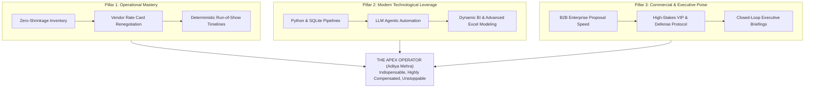

# THE APEX OPERATING DOCTRINE
## The Sovereign Code: From Zero to Irreplaceable Global Operator
**Candidate / Operator:** Aditya Mehra (Adi)  
**Location:** Bengaluru, Karnataka, India  
**System Status:** Full Leverage Active | Zero Hallucination | 100% Provenance

---

## 1. The Core Philosophy: The Sovereign Operator Mindset

Most professionals approach employment as a passive transaction: *"Give me tasks, and I will trade time for a monthly paycheck."*  
The **Apex Working Man** approaches work as a sovereign capital asset: *"I enter any ecosystem as a force multiplier. I absorb chaos, establish deterministic order, compress timelines, eliminate waste, and generate measurable enterprise surplus."*

### The 7 Reality Laws of the Apex Operator

1. **Radical Accountability (The Chaos Sink)**  
   When something breaks in an operation, an amateur looks for who to blame; the Sovereign Operator steps in front of it and says: *"I have the lead. Here is the containment plan, here is the recovery timeline, and here is how we ensure it never happens again."* You become the person leadership breathes a sigh of relief when they see you in the room.

2. **The 10x Leverage Principle (Stop Doing Manual Labor)**  
   Hard work without leverage is exhaustion. Hard work with leverage is empire building. You stack leverage at every layer:
   - **Code & Automation:** Automate spreadsheet reconciliation, reporting, and scraper pipelines with Python and SQLite.
   - **AI Synthesis:** Use Google Gemini, Claude, and modern LLM reasoning to draft executive summaries, analyze contract clauses, and triage 1,000 rows of vendor data in 5 minutes instead of 8 hours.
   - **Relational Leverage:** Harness your 9,223 verified professional connections—knowing exactly who to contact for logistics clearances, vendor rate cards, or fast-track client approvals.

3. **Zero-Defect Grounding (Truth Layer)**  
   You never need to embellish or hallucinate. Your real-world foundation is already formidable:
   - Frontline commercial and inventory accountability since age 17 in Kolkata family retail enterprise.
   - Direct execution across 300+ high-stress live events and brand forums (Puma, HP, Intel, Tata Communications, Razorpay).
   - Military-grade physical security and inventory governance at **AERO INDIA 2025** (100,000+ visitors, 0% asset loss).
   - High-precision AI dataset curation for warehouse robotics at **Instawork AI** (99%+ QA benchmark).
   - Milestone B2B commercial closures at **Pencil Mark Interior Solutions** (₹1.5L+ closed revenue, 18% conversion lift, Written Management Commendation).
   - International Business BBA from Dayananda Sagar University (DSU), Bengaluru.

4. **Speed as a Competitive Weapon**  
   In the corporate world, 90% of delays are caused by procrastination, hesitation, and bureaucratic paralysis. The Apex Operator moves with decisive velocity. If a client needs a proposal, it arrives in 24 hours, not 5 days. If a vendor contract requires rate benchmarking, it is completed before the end of the day. Speed creates reputation; reputation commands premium compensation.

5. **Deep Modules with Simple Interfaces**  
   Inside your workspace or department, your processes may be sophisticated (Python scripts, automated validation rules, structured databases), but what you present to executives and clients is clean, concise, elegant, and frictionless. You deliver answers, not homework.

6. **Emotional Equilibrium & Grace Under Pressure**  
   Whether dealing with a sudden stage equipment failure minutes before a Grammy-winning artist performs (Trilogy Concert) or managing thousands of delegates at an Air Force base, panic is eliminated. Your presence de-escalates stress for your team and inspires total confidence in executive leadership.

7. **Ponytail Minimalism (Lazy Senior Dev Wisdom)**  
   Never build what you can eliminate. Stop at the rungs of The Ladder:
   - *Does this report even need to exist?* If nobody reads it, eliminate it.
   - *Can standard Excel or a 10-line Python script solve it?* Do that instead of purchasing a bloated software tool.
   - *Only write custom code or systems when it drives direct margin or operational clarity.*

---

## 2. The Identity Shift: From "Fresher" to "High-Impact Commercial Operator"

Discard the label of "inexperienced fresher." Age is not competence; execution velocity is competence. 

| Dimension | Typical Fresher / Average Employee | The Apex Sovereign Operator (Aditya Mehra) |
| :--- | :--- | :--- |
| **Value Proposition** | "I have a degree and want a job to learn." | "I bring 8+ years of business exposure, 300+ executed deployments, verified commercial revenue, and automated workflow capability to solve operational bottlenecks from Day 1." |
| **Problem Solving** | Waits for step-by-step instructions. | Anticipates friction, formulates 3 solutions with pros/cons, and recommends the optimal path. |
| **Tooling** | Basic MS Word, slow manual typing. | Python automation, advanced dynamic Excel/SQL, AI copilots, fast API scripting. |
| **Vendor Management** | Accepts initial quoted pricing. | Restructures rate cards directly with tier-1 suppliers, eliminating 15–20% intermediary markups. |
| **Communication** | Vague, passive, defensive. | Structured, metric-backed, executive-ready (Minto Pyramid principle). |
| **Reliability** | Variable; misses follow-ups. | 100% SLA compliance; closed-loop communication on every task. |

---

## 3. The 3 Immutable Pillars of Indispensability

1. **Operational Mastery:** The ability to physically manage complex logistics, vendor contracts, supply chains, and emergency escalations without slipping.
2. **Technological Leverage:** The ability to write code, deploy AI agents, automate manual data entry, and produce analytical insights faster than entire teams.
3. **Commercial & Executive Poise:** The ability to close deals, interface with C-Suite leaders, speak the language of profit and margins, and negotiate favorable outcomes.
