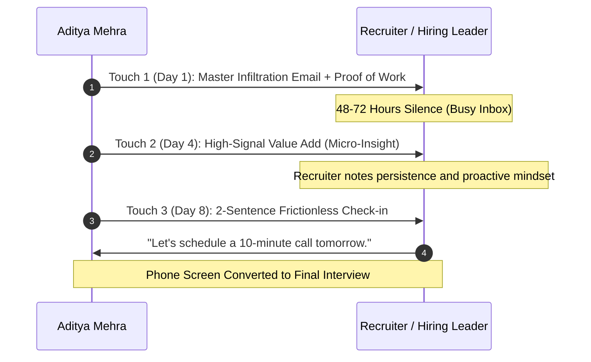

# RECRUITER INFILTRATION & HIGH-LEVERAGE OUTREACH ENGINE
## Harnessing the 9,223 Connection Dataset (1,449 Recruiters | 736 C-Suite | 1,078 Tier 1 MNCs)
**Operator:** Aditya Mehra (Adi) | **Location:** Bengaluru, India | **Status:** Immediate Joiner

---

## 1. The Strategy: Infiltration vs. Generic Job Boards

Applying on LinkedIn or Naukri like an average applicant is a low-yield lottery (1 in 500 odds).  
The **Apex Working Man** uses direct asymmetric infiltration:
1. **Target Identification:** Identify the hiring manager, Head of Operations, VP, or direct Talent Acquisition specialist using your 9,223 pre-existing connections.
2. **Proof-of-Work Hook:** Never ask for a job. Lead with verifiable proof of work (AERO India 2025, 300+ events, Instawork 99%+ AI QA, Pencil Mark ₹1.5L+ revenue).
3. **Frictionless Call to Action (CTA):** Ask for a 10-minute introductory phone screen or offer a sample work sprint.
4. **Immediate Joiner Status:** Emphasize 0-day notice period. In Bengaluru, hiring managers lose 40% of candidates to 90-day notice dropouts. Being an **Immediate Joiner** is an enormous tactical advantage.

---

## 2. Master Outreach Templates

### Template 1: Direct Infiltration to HR / Talent Acquisition (MNC & Tier-1)
*Context: 1,449 HR/Recruiters in network (Accenture, Deloitte, Amazon, EY, KPMG, TE Connectivity)*

> **Subject:** Application: Business Operations / Process Analyst — Aditya Mehra (Immediate Joiner | BBA DSU)
>
> Hi [First Name],
> 
> I noticed you lead talent acquisition for [Department / Operations] at [Company Name].
> 
> Rather than a standard application, here is my direct proof of work:
> 1. **Operations Rigor:** Executed 300+ live commercial operations deployments across Bengaluru; achieved a 15%–20% procurement cost reduction by renegotiating primary vendor rate cards directly.
> 2. **High-Stakes Governance:** Commanded 7-day physical operations at AERO INDIA 2025 (Yelahanka Air Force Station) under strict Ministry of Defence clearances with 100k+ attendees and 0% inventory shrinkage.
> 3. **Commercial Execution:** Closed ₹1.5L+ in commercial contract revenue with an 18% pipeline conversion lift at Pencil Mark Interior Solutions (awarded written management commendation).
> 4. **AI & Analytical Tools:** Advanced MS Excel (dynamic pivots, XLOOKUP), Python automation pipelines, and audited robotics ML datasets at Instawork AI at 99%+ QA benchmark.
> 
> I hold a BBA in International Business from Dayananda Sagar University (Class of 2026) and have **0 days notice period (Immediate Joiner)**.
> 
> My 1-page ATS resume and proof-of-work portfolio are attached here: [adi-digital-universe.ai.studio](https://adi-digital-universe.ai.studio/).
> 
> Could we connect for a brief 7-minute introductory call this week?
> 
> Best regards,  
> **Aditya Mehra**  
> +91 70034 56624 | Bengaluru, Karnataka

---

### Template 2: Executive Infiltration to C-Suite / Founders / VPs
*Context: 736 Founders & C-Suite leaders in network (Startups, Growth Scale-ups, Founder's Office)*

> **Subject:** Operator for [Company Name] — Zero-Defect Execution & Immediate Availability
> 
> Hi [First Name],
> 
> Fast-growing teams usually face one chronic bottleneck: operational drag. You need someone who can absorb chaos, manage vendors, automate spreadsheets, and execute without needing their hand held.
> 
> I am writing to be that force multiplier in your Founder's Office / Operations team.
> 
> What I bring to the table on Day 1:
> - **Field Execution Under Pressure:** Directed on-ground operations across 300+ live commercial projects; led pavilion logistics at AERO INDIA 2025 with 0% asset loss under military security.
> - **Commercial Results:** Drove ₹1.5L+ in enterprise B2B sales in 8 weeks at Pencil Mark Interior Solutions, earning a written commendation from leadership.
> - **Modern Leverage:** I don't just do manual tasks—I build Python/SQLite automation scripts and use AI agent workflows to turn 8-hour data reconciliations into 15-minute automated jobs.
> - **Availability:** Based in Bengaluru, BBA in International Business (Dayananda Sagar University), **Immediate Joiner (0 days notice)**.
> 
> Give me a high-friction operational problem you're currently dealing with, and let me draft a 1-page execution plan for free.
> 
> Best,  
> **Aditya Mehra**  
> +91 70034 56624 | [LinkedIn Profile](https://linkedin.com/in/aditya-mehra-b8644b326)

---

### Template 3: Mutual Connection / Alumni Referral Infiltration
*Context: Connecting through DSU Alumni, mutual connections, or shared groups*

> **Subject:** Dayananda Sagar University Alum / Mutual Connection — Operations at [Company Name]
> 
> Hi [First Name],
> 
> I hope you're having a productive week! I came across your profile through [DSU Alumni Network / our mutual connection] and have been following the incredible work your team is doing at [Company Name].
> 
> I am graduating from Dayananda Sagar University (BBA International Business, 2026) and actively exploring entry-level Operations / Business Analyst openings at [Company Name].
> 
> During my degree, I've focused heavily on real-world execution:
> - 300+ live commercial activations managed across Bengaluru (Puma, Intel, HP).
> - 15%–20% procurement savings achieved through direct vendor negotiations.
> - AI data quality auditing at Instawork AI (99%+ benchmark).
> - Immediate availability with 0 days notice.
> 
> Would you be open to forwarding my resume to your internal recruitment team or sharing 5 minutes of guidance on the optimal way to get in front of the hiring team?
> 
> I would be deeply grateful for your support.
> 
> Warm regards,  
> **Aditya Mehra**  
> +91 70034 56624

---

### Template 4: LinkedIn Connection Request Note (300 Character Limit)
*Context: When adding recruiters and hiring managers on LinkedIn*

> **Option A (HR/Recruiter):**  
> "Hi [First Name], I noticed you handle Operations hiring at [Company]. I'm a DSU BBA graduate (Operations/International Business) with 300+ live deployments, AERO India 2025 logistics lead, and 0 days notice. Would love to connect and share my 1-page ATS profile!"
> 
> **Option B (Founder/Leader):**  
> "Hi [First Name], love your momentum at [Company]. I'm an operations generalist in Bangalore with 8+ years business exposure, Python/AI automation skills, and verified commercial execution. Would value being in your network for future operational needs."

---

## 3. The 4-Touch Follow-Up Cadence

80% of executive responses occur after the 2nd or 3rd follow-up. Most people quit after 1 email; the Apex Operator maintains polite, high-signal persistence.

### Touch 2 (Day 4) — The Value-Add Follow-up
> **Subject:** Re: Application: Business Operations / Process Analyst — Aditya Mehra
> 
> Hi [First Name],
> 
> Following up on my note from earlier this week.
> 
> I know hiring managers at [Company Name] prioritize candidates who can hit the ground running with zero onboarding friction. 
> 
> To demonstrate that, I put together a quick 3-point breakdown of how I typically audit vendor rate cards to unlock 15% immediate cost savings on operational line items: [link or quick 2-bullet summary].
> 
> Happy to share my full ATS resume or jump on a quick 5-minute call if you have 10 minutes open on Thursday or Friday.
> 
> Best,  
> Aditya (+91 70034 56624)

### Touch 3 (Day 8) — The Frictionless Check-in
> **Subject:** Re: Application: Business Operations / Process Analyst — Aditya Mehra
> 
> Hi [First Name],
> 
> Quick check-in to see if you're actively reviewing candidates for Business Operations / Analyst positions this month.
> 
> As an immediate joiner with verified experience across 300+ projects and AI operations, I'm ready to start with 0 days notice.
> 
> Best,  
> Aditya

### Touch 4 (Day 14) — The High-Status Graceful Close
> **Subject:** Re: Application: Business Operations / Process Analyst — Aditya Mehra
> 
> Hi [First Name],
> 
> I assume your team is heads-down or this role is currently on hold, so I won't crowd your inbox further.
> 
> If operational priorities shift or you need a reliable, high-agency operator in Bengaluru down the line, my door is always open: adityamehra799@gmail.com / +91 70034 56624.
> 
> Wishing you and the [Company Name] team continued success!
> 
> Best regards,  
> Aditya Mehra

---

## 4. Phone Screen & WhatsApp Triage Script

When an HR recruiter calls or messages on WhatsApp:

**WhatsApp Initial Response:**
> "Hi [Name]! Thank you for reaching out. Yes, I am actively exploring Business Operations and Process Analyst roles in Bengaluru. I am an immediate joiner with 0 days notice period. When would be a great time for a brief 10-minute introductory call today?"

**Phone Screen Opening Statement (First 60 Seconds):**
> "Hi [Name], thank you for the call. To give you a quick 45-second overview: I'm graduating with a BBA in International Business from Dayananda Sagar University, but my operational foundation started much earlier. Over the past 8 years, starting in our family enterprise and continuing through 300+ live commercial deployments across Bengaluru, I've managed vendor contracts, saved 15-20% on procurement budgets, coordinated high-security logistics at AERO India 2025, and audited robotics AI data at Instawork AI with 99%+ accuracy. Because I have completed my degree requirements, I have 0 days notice period and can join immediately. I'm excited about this opportunity at [Company] because [1 specific reason about company]."
