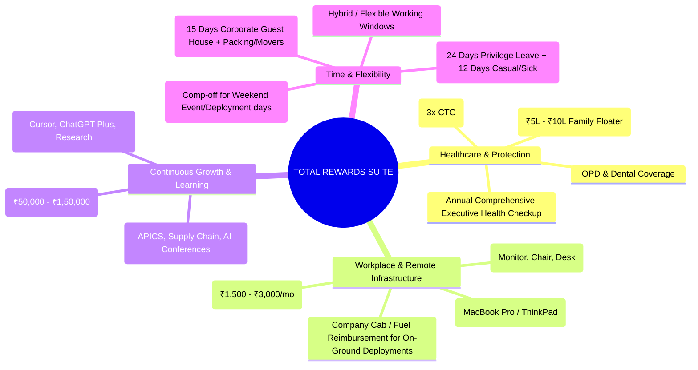

# COMPENSATION, BENEFITS & NEGOTIATION PLAYBOOK
## Maximizing Total Rewards, Equity, and Sovereign Take-Home Wealth
**Candidate:** Aditya Mehra (Adi) | **Baseline Anchor:** ₹6,00,000 – ₹12,00,000 INR  
**Focus:** Indian MNC, Tier-1 Tech, Global Capability Centers (GCCs), and High-Growth Scale-ups

---

## 1. Corporate Compensation Architecture (Demystified)

Never evaluate an offer based on a single number. An offer is a multi-dimensional financial contract.

```
Total Cost to Company (CTC) = Fixed CTC + Variable / Performance Bonus + Retirals + Perks / Benefits
```

| Component | Standard % of CTC | Strategic Value & Tax Impact |
| :--- | :--- | :--- |
| **Basic Salary** | 40% – 50% | Foundation for PF, Gratuity, and HRA. Keep around 40-50% to balance retiral savings with monthly in-hand cash. |
| **House Rent Allowance (HRA)** | 40% – 50% of Basic | 100% tax-exemptible against rent paid under Section 10(13A) of Income Tax Act. |
| **Special Allowance / Flexi-Pay** | Balance amount | Fully taxable, but provides immediate liquidity for investments and operations. |
| **Employer Provident Fund (PF)** | 12% of Basic | Mandatory tax-deferred savings compounding at government rate (~8.15%–8.25%). |
| **Gratuity** | ~4.81% of Basic | Payable after 5 years under Gratuity Act, or prorated in executive exits. Tax-exempt up to ₹20 Lakhs. |
| **Performance Bonus / Variable** | 10% – 25% | Tied to team/individual KPIs. Always negotiate clear, objective milestone criteria. |
| **Joining / Sign-on Bonus** | One-time cash (₹50k – ₹2L) | Immediate upfront liquidity; usually subject to a 1-year clawback clause. |
| **Stock Options / ESOPs** | Equity units | Massive upside in venture-backed scale-ups. Standard: 4-year vesting with 1-year cliff. |

---

## 2. The Comprehensive Benefits & Perks Master Checklist

When negotiating an offer, most candidates obsess over base salary and ignore benefits worth ₹2,00,000 to ₹4,00,000 annually. You must audit and negotiate the complete suite:



1. **Healthcare & Protection:**
   - [ ] Comprehensive Group Medical Insurance with ₹5,00,000 to ₹10,00,000 sum insured covering self and parents.
   - [ ] OPD (Outpatient Department) allowance or tele-health coverage for routine consultations and prescription medicines.
   - [ ] Group Term Life Insurance (3x to 5x annual CTC) and Accidental Disability Insurance.

2. **Technology & Remote Setup:**
   - [ ] Dedicated corporate workstation: Apple MacBook Pro M-series or high-spec Lenovo ThinkPad with 32GB RAM.
   - [ ] One-time Home Office Setup Stipend (₹25,000 to ₹50,000) for external 4K monitor, mechanical keyboard, and ergonomic chair.
   - [ ] Monthly Broadband / Cellular Data Reimbursement (₹1,500 to ₹3,000/month).

3. **Field Operations & Travel:**
   - [ ] 100% company cab or per-kilometer fuel reimbursement for on-ground client visits, venue inspections, and vendor audits.
   - [ ] Daily out-of-pocket meal allowance (Per Diem) during on-site deployments.

4. **Continuous Learning & Skill Compounding:**
   - [ ] Guaranteed Annual Learning Stipend (₹50,000 to ₹1,00,000) for professional certifications (APICS CSCP, PMP, AWS/Cloud, AI Prompting).
   - [ ] Corporate subscription access to AI tools (ChatGPT Enterprise, Claude, Copilot).

5. **Leave & Work-Life Balance:**
   - [ ] Minimum 24 days Privilege Leave (PL) + 12 days Casual/Sick Leave (CL/SL) annually.
   - [ ] Explicit **Compensatory Off (Comp-off)** policy: every Saturday/Sunday spent on field operations or event supervision must earn an equivalent weekday off.

---

## 3. Word-for-Word Salary Negotiation Battlecards

### Script 1: Handling "What is your current CTC and expected CTC?"
*Rule: Never give a low single number; anchor with a market range backed by value.*

> **Candidate Response:**  
> "As I am completing my BBA in International Business at Dayananda Sagar University and joining immediately, I don't have a corporate prior CTC constraint. 
> 
> However, based on the operational scope of this role—managing multi-vendor SLAs, driving 15%–20% procurement savings, and building automated data workflows—I am evaluating opportunities in Bengaluru that offer a total CTC in the range of **₹6.5 to ₹8.5 Lakhs** per annum, depending on the variable structure and benefits. 
> 
> My primary focus is joining an organization where I can deliver immediate operational leverage from Day 1. What is the budgeted band for this position?"

---

### Script 2: Countering an Initial Low Offer (The "Deconstruct & Elevate" Tactic)
*Scenario: HR offers ₹4.5 Lakhs CTC.*

> **Candidate Response:**  
> "Hi [HR Name], thank you so much for extending the offer. I am genuinely enthusiastic about the mission at [Company Name] and the team's operational goals.
> 
> I reviewed the offer breakdown of ₹4.5 Lakhs. While I appreciate the baseline, this sits below the market band for candidates who bring verified proof of work. 
> 
> Unlike a typical graduate who requires 3 to 6 months of training before becoming productive, I bring 8 years of business exposure, 300+ executed deployments, verified commercial sales revenue, and automated Python/AI scripting capabilities that will immediately eliminate operational friction.
> 
> If we can structure the total CTC at **₹6.0 to ₹6.5 Lakhs**—or bridge the difference with a **₹50,000 joining bonus** and a **6-month accelerated performance review**—I am prepared to sign the offer letter and begin onboarding this Monday. Can we explore adjusting that structure?"

---

### Script 3: Negotiating When HR Claims "Company Policy Has a Fixed Fresher Grid"
*Scenario: "Our campus/fresher salary is fixed by HR policy and cannot be altered."*

> **Candidate Response:**  
> "I completely understand and respect that [Company Name] has standardized salary bands for standard fresher intake.
> 
> However, as we discussed throughout the technical rounds, my operational background—running high-security exhibition logistics at AERO INDIA 2025 with zero shrinkage, managing 15+ concurrent client pipelines, and auditing AI data at 99%+ accuracy—falls into the category of an experienced operational contributor rather than a blank-slate fresher.
> 
> If the fixed base CTC is truly non-negotiable due to policy bands, can we look at non-grid levers:
> 1. A one-time sign-on bonus to bridge the gap.
> 2. A contractual agreement for a formal performance and compensation review at the 6-month milestone rather than waiting 12 months.
> 3. Additional learning and certification allowance to support my domain expertise.
> 
> Which of those levers gives you the most flexibility to recognize the value I'll be creating?"

---

## 4. Tax Optimization & Net In-Hand Maximization

Earning gross CTC is vanity; maximizing net in-hand and investable cash flow is sanity.

### Key Structuring Strategies:
1. **Optimize HRA (House Rent Allowance):**
   - Under Section 10(13A), you can claim the minimum of:
     - Actual HRA received.
     - Rent paid minus 10% of Basic salary.
     - 50% of Basic salary (for Bengaluru / metro cities).
   - *Ensure rental agreements and rent receipts (with landlord PAN if rent > ₹1L/year) are properly filed.*

2. **Corporate NPS (National Pension System) — Section 80CCD(2):**
   - Request that the employer allocate up to 10% of your Basic salary directly into Corporate NPS.
   - This deduction is available **over and above** standard limits and is 100% tax-exempt in both the old and new tax regimes.

3. **Reimbursement Basket Optimization:**
   - Structure parts of the special allowance as tax-free reimbursements:
     - Broadband / Mobile Phone reimbursement (bills produced monthly).
     - Books & Professional Periodicals allowance.
     - Food coupons (e.g. Pluxee / Sodexo) up to ₹2,200/month.
