# THE 30-60-90 DAY INDISPENSABLE OPERATOR BLUEPRINT
## How to Enter Any Organization and Become Completely Irreplaceable
**Candidate:** Aditya Mehra (Adi) | **Doctrine:** Speed, Reliability, Automation, Enterprise Margin

---

## 1. The Strategy: The Three Horizons of Power

When an average employee joins a company, they spend 90 days "getting up to speed" and waiting for instructions.  
The **Apex Working Man** executes a calculated three-phase campaign:
- **Days 1–30 (Absorb & Stabilize):** Learn the plumbing, map the human and political landscape, identify pain points, and execute every micro-task with 100% precision.
- **Days 31–60 (Automate & Systematize):** Eliminate manual friction, build Python/AI automation scripts for reporting, author standard operating procedures (SOPs), and earn the trust of cross-functional teams.
- **Days 61–90 (Compounding & Expansion):** Own mission-critical deliverables, propose structural cost/time savings, and make yourself the single person leadership depends on for high-stakes projects.

```mermaid
gantt
    title 30-60-90 Day Indispensable Execution Roadmap
    dateFormat  X
    axisFormat Day %d
    
    section Phase 1 (Days 1-30)
    Ecosystem & Workflow Mapping      :active, 0, 10
    Shadow Org Chart Identification   :0, 15
    Flawless Micro-Task Execution     :5, 30
    Quick Win Milestone Delivered     :20, 30

    section Phase 2 (Days 31-60)
    Audit Manual Spreadsheet Waste    :30, 45
    Deploy Python/AI Automations      :40, 55
    Author Departmental SOPs          :45, 60
    Cross-Department Trust Building   :35, 60

    section Phase 3 (Days 61-90)
    Propose Strategic Cost Reductions :60, 75
    Own High-Stakes Project SLA       :65, 90
    Executive 1-Pager Briefing Cadence:60, 90
    Formal 90-Day Performance Audit  :85, 90
```

---

## 2. Phase 1: Days 1–30 — Absorb, Stabilize & Map the Ecosystem

### Objective: Zero errors, total reliability, and complete institutional comprehension.

1. **Map the "Shadow Org Chart":**
   - The official org chart tells you who reports to whom; the *shadow org chart* tells you who actually gets things done.
   - Identify:
     * Who is the executive assistant or operations lead who holds the keys to scheduling and approvals?
     * Which senior engineer or analyst possesses all the historical data and institutional knowledge?
     * Who is the quiet problem-solver that everyone runs to when things go wrong?
   - Build genuine rapport with these individuals immediately.

2. **Master the Existing Tooling & Files:**
   - Locate every departmental spreadsheet, shared drive, CRM board, and ERP pipeline.
   - Read the last 6 months of meeting minutes, quarterly reviews, and vendor contracts.
   - Understand the team's Top 3 KPIs and what metrics keep your manager awake at night.

3. **Deliver the "Quick Win" (Day 21 Rule):**
   - Identify one annoying, repetitive task that everyone hates doing (e.g., manually formatting weekly vendor tracker tables or cleaning raw client contact dumps).
   - Quietly solve it or clean it up ahead of schedule without fanfare: *"Hey team, noticed this vendor tracker had formatting discrepancies, so I cleaned and normalized the data for this week's review."*

4. **The "Closed Loop" Communication Rule:**
   - Never let a task hang. When assigned an action item:
     * Confirm receipt within 30 minutes with an estimated delivery time.
     * If completed: confirm completion with a concise summary.
     * If blocked: raise the blocker immediately with a proposed solution, never just a complaint.

---

## 3. Phase 2: Days 31–60 — Automate & Systematize

### Objective: Turn manual effort into deterministic software-assisted systems.

1. **Audit Manual Spreadsheet Hours:**
   - Look around your team: where are colleagues spending 2–3 hours every day copying data between Excel sheets, typing manual emails, or tracking down vendor sign-offs?
   - Write a simple Python script, SQLite query, or automated Excel Power Query workflow to automate the repetitive parts.
   - Compress the 3-hour daily chore into a 1-click 3-minute operation.

2. **Author High-Clarity Standard Operating Procedures (SOPs):**
   - Document recurring workflows into clear, foolproof checklists (Step 1, Step 2, Step 3 with screenshots).
   - Why? Because when you document a process, you own that process. It proves you understand the architecture better than anyone else.

3. **Vendor & Partner Governance:**
   - Apply the lesson from your 300+ event deployments and AERO INDIA 2025: audit vendor turnaround times against agreed SLAs.
   - Identify any vendor or supplier that is overcharging or underdelivering, and present a polite, metric-based renegotiation proposal to your manager.

4. **Establish the Weekly Executive 1-Pager:**
   - Send your manager a clean, 1-page bulleted status update every Friday at 4:00 PM:
     * **Accomplished this week:** (3 key outcomes with metrics).
     * **In-progress for next week:** (Top 3 priorities).
     * **Blockers / Support needed:** (Clear decisions required).

---

## 4. Phase 3: Days 61–90 — Scale, Own & Become Indispensable

### Objective: Position yourself as an irreplaceable strategic driver of enterprise margin.

1. **Own a High-Stakes Project End-to-End:**
   - When a difficult project, high-profile client escalation, or audit deadline arises, volunteer for the lead: *"I will own the operational timeline for this project."*
   - Execute with the same calm precision you used during the TRILOGY concert and AERO India.

2. **Quantify Your Direct Enterprise ROI:**
   - Before your 90-day review, calculate the exact rupee value or hours saved by your work:
     * *"Automated weekly reporting: saved 12 team hours/week (~₹3,00,000 annualized labor equivalent)."*
     * *"Renegotiated tier-1 vendor rate cards: reduced project procurement costs by 15%."*
     * *"Maintained 100% on-time milestone delivery across all assigned accounts."*

3. **The 90-Day Executive Performance Review Conversation:**
   - Request a formal 30-minute meeting with your manager.
   - Present a concise 2-page dossier showing:
     1. Key Deliverables & Metrics Achieved vs. Initial Goals.
     2. Systems, SOPs, and Automations Built for the Team.
     3. Strategic Roadmap for the Next 6 Months (Expansion & Leadership).
   - This sets the stage for an accelerated compensation appraisal and promotion trajectory.
