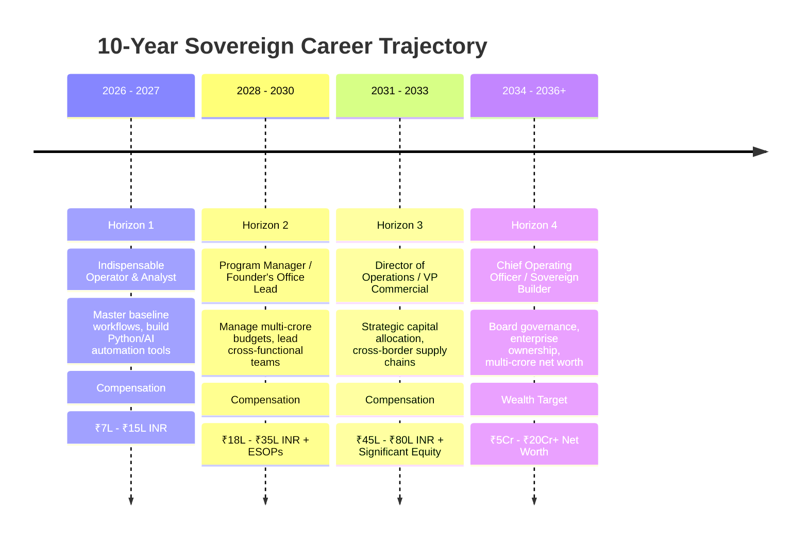

# THE 10-YEAR SOVEREIGN CAREER & WEALTH ROADMAP
## From Frontline Operator to Multi-Crore Enterprise Leader & Sovereign Builder
**Operator:** Aditya Mehra (Adi) | **Temporal Span:** 2026 – 2036 | **Framework:** Continuous Compounding

---

## 1. The Core Equation of Career Sovereignty

True professional wealth and autonomy are not built through linear hourly labor; they are built through the multiplication of three compounding vectors:

$$\text{Sovereign Power} = (\text{Deep Operational Competence}) \times (\text{Technological / AI Leverage}) \times (\text{Asymmetric Relational Capital}) \times (\text{Equity Ownership})$$



---

## 2. Horizon 1 (Years 1–2: 2026 – 2027) — Indispensable Execution & Technical Leverage

### The Mission: Become the most capable, reliable, and automated individual contributor in the organization.
- **Target Roles:** Business Operations Specialist, Process Analyst, AI Operations Lead, Commercial Associate.
- **Target Compensation:** ₹7,00,000 to ₹15,00,000 INR Total CTC.
- **Strategic Focus:**
  1. **Master the Machinery:** Understand every vendor contract, ERP system, CRM pipeline, and operational workflow in the business.
  2. **Automate the Repetitive:** Deploy Python scripts, SQLite databases, and Gemini/Claude prompt workflows to eliminate 50% of your team's manual administrative hours.
  3. **Build the Reputation:** Deliver 100% SLA compliance on every project. Never miss a deadline; communicate proactively.
  4. **Active Network Maintenance:** Connect with 20 new recruiters and senior operators every week from your 9,223 LinkedIn dataset.

---

## 3. Horizon 2 (Years 3–5: 2028 – 2030) — Program Ownership & Team Leadership

### The Mission: Shift from executing tasks to managing systems, budgets, and teams.
- **Target Roles:** Operations Manager, Chief of Staff, Senior Program Manager, Head of Commercial BD.
- **Target Compensation:** ₹18,00,000 to ₹35,00,000 INR Total CTC + Meaningful Equity/ESOP grants.
- **Strategic Focus:**
  1. **P&L Responsibility:** Own an operational budget of ₹1 Crore to ₹5 Crores. Drive structured 15%–20% cost optimization programs across suppliers and vendors.
  2. **People Leadership:** Hire, train, and mentor a team of junior analysts and on-ground operators. Instill the "Zero-Defect" and "Closed-Loop" culture.
  3. **High-Stakes Crisis Ownership:** Be the executive right-hand that leadership taps for turnaround situations, new market rollouts, and facility expansions.
  4. **Industry Thought Leadership:** Publish quarterly operational case studies, teardowns, and supply chain insights on LinkedIn to establish regional authority across Bengaluru and national business circles.

---

## 4. Horizon 3 (Years 6–8: 2031 – 2033) — Executive Leadership & Enterprise Direction

### The Mission: Drive enterprise value, strategic mergers, and international operational scaling.
- **Target Roles:** Director of Global Operations, VP of Commercial Supply Chain, General Manager.
- **Target Compensation:** ₹45,00,000 to ₹80,00,000 INR Total CTC + Executive Stock Vesting.
- **Strategic Focus:**
  1. **Multilateral Operations:** Leverage your International Business BBA foundation to oversee cross-border trade, port clearances, Incoterms governance, and global vendor networks.
  2. **Strategic Vendor Alliances:** Structure long-term multi-million-dollar partnerships with tier-1 global suppliers, eliminating volatility and locking in operating margins.
  3. **Digital & AI Transformation:** Spearhead company-wide agentic automation initiatives, replacing obsolete manual reporting with real-time autonomous cockpits.
  4. **Capital Allocation:** Participate in departmental capital budgeting, headcount planning, and strategic investment reviews.

---

## 5. Horizon 4 (Years 9–10+: 2034 – 2036+) — Sovereign Freedom & Enterprise Ownership

### The Mission: Transition from executive compensation to permanent sovereign equity, enterprise ownership, and wealth compounding.
- **Target Roles:** Chief Operating Officer (COO), Co-Founder, Managing Partner, Strategic Board Advisor.
- **Target Net Worth:** ₹5,00,00,000 to ₹20,00,00,000+ INR in liquid assets and sovereign equity holdings.
- **Strategic Focus:**
  1. **Equity Compounding:** Shift focus entirely to equity value, enterprise profit-sharing, and asset appreciation.
  2. **Venture Incubator / Co-Founding:** Leverage 10 years of operational dominance and an elite network of 15,000+ executives to co-found or scale high-margin infrastructure, trade, or technology ventures.
  3. **Sovereign Capital Deployment:** Allocate capital into diversified real-world assets: commercial real estate, index funds, private equity, and sovereign debt instruments.
  4. **Mentorship & Legacy:** Build a lineage of exceptional operators, establishing an academy of high-agency talent operating across global markets.

---

## 6. The Sovereign Habit Stacking Matrix

```
SKILL STACKING = Operations Rigor + AI Automation + B2B Commercial Sales + EXIM Finance
```

To maintain an unassailable edge over 10 years, maintain these four daily/weekly disciplines:
1. **The Code & AI Discipline (Weekly):** Dedicate 3 hours every weekend to building new automation tools, experimenting with cutting-edge AI models, and optimizing your scripts.
2. **The Commercial Deal Discipline (Monthly):** Stay sharp by negotiating every major contract, personal purchase, or business rate card—never accept the sticker price.
3. **The Relationship Compounding Discipline (Daily):** Send 1 thoughtful, value-added note to someone in your professional network every single day (365 touchpoints per year).
4. **The Health & Stamina Discipline (Daily):** Lift heavy, walk 10,000 steps, eat clean, and sleep 8 hours. Physical energy is the battery that powers the entire sovereign engine.
