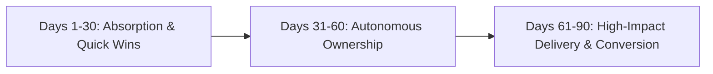

# DAY 30-60-90 EXECUTION BLUEPRINT
## Product Manager / Business Analyst Intern - Summer 2027 | American Express

### Days 1 – 30: Rapid Onboarding & Baseline Mapping
- **System Immersion**: Complete security credentials, environment setups, and internal tooling walkthroughs.
- **Stakeholder Interviews**: Meet with 10+ cross-functional partners to understand pain points, SLAs, and current metrics.
- **Quick Win Delivery**: Identify and ship fixes for 2-3 backlog operational snags or data dashboard discrepancies.

### Days 31 – 60: Deep Ownership & Process Optimization
- **Core Project Execution**: Assume primary ownership of designated internship deliverables around Define product requirements for digital payment authorization workflows, merchant fraud deterrence systems, and customer loyalty engines..
- **Telemetry & Automation**: Build automated reporting scripts (Product Management, FinTech Architecture, Regulatory Compliance, User Journey Mapping, Scrum/Agile) to replace manual reporting steps.
- **Mid-Term Review**: Present preliminary project findings to managers, gathering feedback to calibrate final milestones.

### Days 61 – 90: Enterprise Impact & Full-Time Conversion
- **Project Handoff & Documentation**: Author complete living documentation, SOPs, and runbooks so work is sustainable.
- **Executive Presentation**: Deliver a polished showcase demonstrating quantitative business value (time saved, cost reduced, or accuracy gained).
- **Return Offer Alignment**: Conduct formal debrief with team leadership regarding full-time graduate opportunities.
