# ADITYA MEHRA — THE APEX 2027 MASTER BLUEPRINT
## "Becoming the Best of the Best in Everything": Commercial, Financial, Biological, AI & Character Supremacy

**Author:** Antigravity Autonomous Executive Engine  
**Subject:** Aditya Mehra (Age 25, Turning 26 January 2027)  
**Location:** Bengaluru, Karnataka, India  
**Target Milestone:** #1 Top-Decile Commercial Operator, Complete ₹30 Lakh Debt Elimination, Peak Physical Resilience, Top 0.1% AI Superhuman Builder  
**Date of Ratification:** November 3, 2026  

---

## 0. The Manifesto: What "Best of the Best" Means

Being "the best of the best" is not a vague motivational quote. In 2027, for Aditya Mehra, it means a measurable, indisputable reality:

1. **In Sales & Commercial Acumen:** Outperforming 99% of tech sales reps in Bengaluru by combining 7 years of on-ground commercial instincts (₹80L+ GMV at Oriflame, IRDAI licensed persistency) with modern MEDDPICC enterprise software qualification.
2. **In Financial Discipline:** Decimating a ₹30 Lakh loan with mathematical certainty, eliminating financial anxiety forever, and guaranteeing a permanent ₹35,000/month living fortress for his mother and household.
3. **In Biological Endurance:** Turning the night shift (BrightCHAMPS 7:30 PM – 4:30 AM IST) from a health hazard into an unfair advantage through circadian photobiology, clean nutrition, and physical conditioning.
4. **In Technical & AI Mastery:** Operating at the frontier of AI—building custom MCP servers, agentic outbound engines, and rapid full-stack prototypes faster than an entire engineering squad.
5. **In Gravitas & Integrity:** Walking into any boardroom or executive meeting in Bengaluru with unshakable presence, zero defensiveness, and verified proof of work.

---

## 1. Pillar I: Enterprise Tech GTM & Commercial Dominance

### The Problem With Ordinary Sales Reps
Most sales reps in India rely on high-volume spray-and-pray emails, reading basic product feature sheets, and getting nervous on calls with senior executives.

### Aditya’s 2027 GTM Operating Standard: MEDDPICC Rigor
Aditya does not sell features; he sells economic outcomes and risk mitigation.

1. **Metrics (M):** Always quantify the prospect's bleeding. Never ask *"What are your challenges?"* Instead, state: *"Companies at your scale typically leak ₹15L–₹30L per quarter in pipeline churn due to delayed lead follow-ups. Are you seeing similar leakage?"*
2. **Economic Buyer (EB):** Identify and engage the person with the P&L budget authority (VP of Sales, CRO, CTO, Founder).
3. **Decision Criteria (DC):** Shape the evaluation criteria before the customer issues an RFP so that Aditya’s solution is the only logical choice.
4. **Decision Process (DP):** Map every step—technical review, security audit, legal compliance, and CFO sign-off—before the contract is even sent.
5. **Identify Pain (IP):** Uncover the personal and operational pain. If this problem isn't solved in 90 days, who loses their job?
6. **Champion (C):** Cultivate an internal insider who has skin in the game and sells Aditya's solution internally when Aditya is not in the room.
7. **Competition (C):** Position against status quo and inertia, which are 80% of lost deals.

### High-Leverage Outbound Engine
* **Target Companies:** DevRev, Sarvam AI, Razorpay, Yellow.ai, Samaaro, Postman, Hasura.
* **Volume:** 5 hyper-personalized, research-backed InMails dispatched daily between 2:00 PM and 3:30 PM IST.
* **The Pitch Hook:** Highlight 7 years of commercial skin-in-the-game backed by Form 26AS (Section 194H/194D) to instantly differentiate from freshers.

---

## 2. Pillar II: Financial Armor & ₹30 Lakh Debt Decimation

### The Triple-Stream Revenue Model (₹1.8L – ₹2.1L / Month)
Aditya will not rely on a single fragile salary. Three synchronized revenue streams create an unassailable financial fortress:

$$\begin{aligned}
\text{Stream 1 (Tier-1 Tech GTM In-Hand)} &: \mathbf{₹1,15,000/\text{mo}} \quad (\text{₹16L - ₹18L CTC}) \\
\text{Stream 2 (Oriflame Network Royalty)} &: \mathbf{₹45,000/\text{mo}} \quad (\text{Top 21\% Level, 50+ Partners}) \\
\text{Stream 3 (Bajaj Allianz Life Renewals)} &: \mathbf{₹20,000/\text{mo}} \quad (>85\% \text{ Persistency Commission}) \\
\hline
\mathbf{\text{Total Monthly Cash Inflow}} &\mathbf{:} \mathbf{₹1,80,000 - ₹2,10,000/\text{mo}}
\end{aligned}$$

### Capital Allocation & Debt Prepayment Architecture

1. **The Family Living Ringfence (₹35,000 / Month):**
   * Rent & Home Utilities: ₹18,000
   * High-Protein Groceries & Nutrition: ₹12,000
   * Mother's Medical & Health Shield: ₹5,000
   * *Rule:* This fund is non-negotiable and transferred on the 1st of every month. It protects Aditya's psychological foundation.

2. **The Liquid Emergency Shield (Target: ₹1,50,000):**
   * Built gradually over Months 1–4 (allocating ₹15,000/mo).
   * Kept in an instant-access liquid account to prevent ever needing short-term credit again.

3. **Accelerated Principal Debt Prepayment (₹1,45,000 / Month):**
   * Every single rupee of surplus is credited **directly against the principal loan balance** to collapse interest compounding.
   * Month 1 (Nov 2026): ₹30,00,000
   * Month 6 (May 2027): ₹19,20,000
   * Month 12 (Nov 2027): ₹5,50,000
   * **Month 15 (February 2028): ₹0.00 — 100% DEBT-FREE VICTORY.**

---

## 3. Pillar III: Biological & Circadian Steel Armor

Working the BrightCHAMPS US Shift (7:30 PM – 4:30 AM IST) while building an elite daytime tech career demands world-class biological discipline.

```mermaid
gantt
    title Aditya's 24-Hour Circadian Master Schedule
    dateFormat  HH:mm
    axisFormat  %H:%M
    section Biology & Rest
    Blackout Deep Sleep          :05:00, 06h30m
    Light Therapy & Hydration   :11:30, 01h00m
    Physical Training (Weights)  :12:30, 01h30m
    section Career & Intel
    Daytime Outbound & Coding    :14:00, 04h00m
    Family Dinner & Rest         :18:00, 01h30m
    section Operational Shift
    BrightCHAMPS US Shift        :19:30, 09h00m
```

### Photobiology & Sleep Hygiene (Huberman Protocol)
1. **04:30 AM Shift Conclusion:** Put on red/amber blue-blocking glasses immediately upon closing the laptop.
2. **05:00 AM – 11:30 AM Sleep Window:** 100% blackout environment (eye mask + blackout curtains). Room temperature set to 19°–21°C. White noise machine or earplugs to block morning Bengaluru traffic.
3. **11:30 AM Waking Ritual:** Exposure to bright sunlight (or 10,000-lux lamp) for 15 minutes to trigger cortisol pulse and calibrate the circadian clock. Drink 500ml water with a pinch of Himalayan pink salt.
4. **Caffeine Curfew:** No coffee or tea after 1:00 AM IST to ensure full clearance of adenosine before 5:00 AM sleep.

### Physical Conditioning & Nutrition
* **Workout Routine (4x / Week at 12:30 PM):**
  * Day 1: Push (Bench press, overhead dumbbell press, lateral raises, triceps).
  * Day 2: Pull (Deadlifts, pull-ups/lat pulldowns, barbell rows, biceps).
  * Day 3: Legs (Squats, Romanian deadlifts, lunges, calves).
  * Day 4: Upper Body Hypertrophy & Core.
* **Zone 2 Cardiovascular Endurance (2x / Week):** 35 minutes brisk incline treadmill walking at 125–135 BPM heart rate. Increases mitochondrial efficiency and stress resilience.
* **Nutrition:** 130g protein daily (eggs, paneer, chicken/fish, whey isolate). Minimize refined sugars to eliminate energy crashes during shift work.

---

## 4. Pillar IV: AI Superhuman Capability & Vibe Coding

Aditya is an AI-augmented commercial polymath. While competitors rely on slow manual workflows, Aditya leverages autonomous agents:

1. **Model Context Protocol (MCP) Mastery:** Fluent in running and orchestrating local and cloud MCP servers connecting LLMs directly to SQLite databases, CRMs, and automated communication APIs.
2. **Agentic Outbound Pipelines:** Using autonomous scripts to scrape company annual reports, parse executive LinkedIn profiles, extract hiring priorities, and craft customized pitch decks in minutes.
3. **Rapid Prototyping:** Delivering live web mockups and functional POCs to prospective employers and clients before the first meeting, demonstrating instant value.

---

## 5. Pillar V: Stoic Character, Gravitas & Executive Presence

### The Mental Fortress
* **The Dichotomy of Control:** You do not control whether a recruiter replies today or if an interview is rescheduled. You control your preparation, your tone, your posture, your outbound volume, and your physical health.
* **The Power of Emotional Invariance:** When faced with difficult customers or aggressive managers on the US Shift, remain completely composed. Never respond with anger or defensive excuses. Speak with grounded authority.
* **Radical Ownership:** The debt, the family responsibilities, and the career milestones are owned 100% by you. There are no excuses, only execution.

---

## 6. The 2027 Quarter-by-Quarter Execution Roadmap

### Q1 2027 (January – March): The Foundation & The Outbound Surge
* **Milestone 1:** Celebrate 26th Birthday (January 2027) with clear identity as a commercial operator.
* **Milestone 2:** Maintain #1 sales quota ranking at BrightCHAMPS while running 5 daytime tech outreach campaigns per week.
* **Milestone 3:** Secure offers from Tier-1 Bengaluru tech companies (DevRev, Razorpay, Yellow.ai, or Samaaro) with ₹16L–₹20L CTC.
* **Milestone 4:** Reduce loan balance from ₹30L to under ₹25L.

### Q2 2027 (April – June): The Tech Ascension
* **Milestone 1:** Complete smooth, professional handover from BrightCHAMPS.
* **Milestone 2:** Onboard as Enterprise Account Executive or Strategic GTM Lead in Bengaluru.
* **Milestone 3:** Monthly in-hand earnings hit ₹1.8L+.
* **Milestone 4:** Ramp debt prepayments to ₹1.45L/month; loan drops below ₹18L.

### Q3 2027 (July – September): Quota Dominance & Scale
* **Milestone 1:** Close first multi-lakh enterprise ARR contract; establish reputation among sales leadership.
* **Milestone 2:** Fully fund ₹1.5L liquid emergency reserve.
* **Milestone 3:** Apply quarterly performance bonus toward debt principal; loan drops below ₹10L.

### Q4 2027 (October – December): The Sovereign Victory
* **Milestone 1:** Debt balance drops to ₹5.5 Lakhs by November 2027.
* **Milestone 2:** Path fully cleared to reach **₹0.00 ZERO DEBT by February 2028**.
* **Milestone 3:** Stand recognized as one of Bengaluru's most capable young GTM professionals.
* **Milestone 4:** Complete peace of mind and financial security for mother and family.

---

## 7. Direct Command Center Access

All systems are live, interlinked, and executable:
* 🌟 **Master Titan OS Cockpit:** [`ADITYA_APEX_2027_BEST_OF_THE_BEST_OS.html`](file:///e:/anti/ADITYA_APEX_2027_BEST_OF_THE_BEST_OS.html)
* 🔍 **Global Portfolio & Audit Vault:** [`ADITYA_MEHRA_GLOBAL_PORTFOLIO_AND_CROSS_CHECK_AUDIT.html`](file:///e:/anti/ADITYA_MEHRA_GLOBAL_PORTFOLIO_AND_CROSS_CHECK_AUDIT.html)
* 📜 **The Master Chronicles:** [`ADITYA_MEHRA_CHRONICLES_PAST_PRESENT_FUTURE.html`](file:///e:/anti/ADITYA_MEHRA_CHRONICLES_PAST_PRESENT_FUTURE.html)
* 🛡️ **Life Stability Fortress:** [`ADITYA_LIFE_STABILITY_FORTRESS_COCKPIT.html`](file:///e:/anti/ADITYA_LIFE_STABILITY_FORTRESS_COCKPIT.html)
* 💎 **Universal Proof of Work Vault:** [`ADITYA_MEHRA_PROOF_OF_WORK_GLOBAL_VAULT.html`](file:///e:/anti/ADITYA_MEHRA_PROOF_OF_WORK_GLOBAL_VAULT.html)
* 📄 **Printable 1-Page A4 Resume:** [`ADITYA_MEHRA_PRINTABLE_A4_1PAGE_CV.html`](file:///e:/anti/ADITYA_MEHRA_PRINTABLE_A4_1PAGE_CV.html)
* 💰 **Debt-Zero War Room:** [`ADITYA_DEBT_ZERO_30_LAKH_COCKPIT.html`](file:///e:/anti/ADITYA_DEBT_ZERO_30_LAKH_COCKPIT.html)
* 🚀 **1-Click Master Batch Launcher:** [`START_ADITYA_CONQUEST_VAULT.bat`](file:///e:/anti/START_ADITYA_CONQUEST_VAULT.bat)
