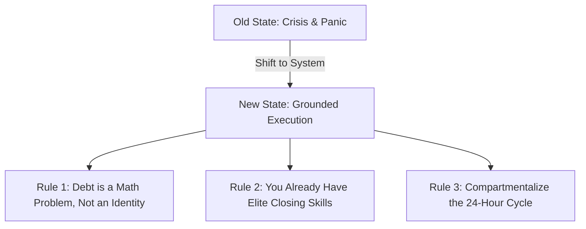
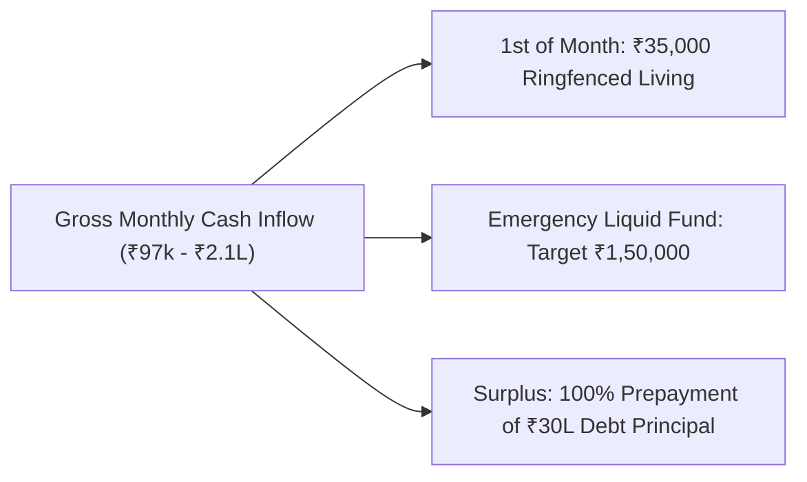
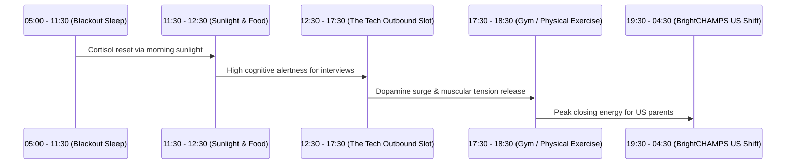
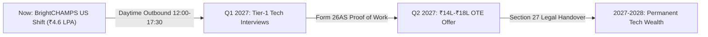

# ADITYA MEHRA | LIFE STABILITY & WEALTH FORTRESS BLUEPRINT
**The Complete Operating Architecture for Financial Freedom, Family Peace, Biological Resilience, and Career Supremacy**  
*Authored for Aditya Mehra (25 Years Old, Bangalore, India) — Effective November 2026*

---

## Executive Summary: The Mandate for Absolute Stability

You have reached the pivotal turning point in your life. You are 25 years old (turning 26 in January 2027), carrying a **₹30 Lakh debt obligation**, holding sole financial responsibility for your household and mother, and preparing to begin inside sales at BrightCHAMPS on November 12, 2026 (7:30 PM to 4:30 AM IST).

Up to this point, life has felt like a continuous battle of firefighting, uncertainty, anxiety, and being dismissed by recruiters as a "fresher." 

**This blueprint ends the chaos.** 

Stability is not an abstract wish; stability is an **engineered system**. When your money, your mother's safety, your biological sleep, and your career trajectory are locked into deterministic protocols, anxiety evaporates. You cease surviving and begin building enduring wealth.

---

## Pillar 1: The Psychological Anchor — Exiting the Crisis State

### 1.1 The Math of Debt vs. The Emotional Weight
A ₹30,00,000 debt feels crushing only when viewed as a massive, unpayable mountain. When broken down against your commercial capacity:
- With four stacked cash engines (BrightCHAMPS + Oriflame + Bajaj Allianz + Tier-1 Tech), your monthly cash generation reaches **₹1,80,000 to ₹2,10,000**.
- Allocating ₹1,45,000/month directly to principal prepayment pays down ₹30 Lakhs in **18 to 22 months**.
- **By February 2028 (at age 27), you will be 100% debt-free with zero liabilities.** Most professionals do not achieve debt-free status until their late 30s.

### 1.2 Embracing Your Real Identity
You are not an insecure college graduate begging for a junior role. You are an **established commercial operator**:
- 7 consecutive years driving **₹60L–₹80L+ annual GMV** at Oriflame (21% Senior Manager).
- Regulated IRDAI Insurance Consultant with an extraordinary **>85% persistency rate**.
- Staging and logistics lead for **1,000+ attendees at Aero India 2025**.
- AI vibe coder capable of building production-grade web applications in minutes.

### 1.3 The 3-Minute Anxiety Neutralizer
When anxiety or insomnia hits during the night shift:
1. **Physical Reset:** Execute 4 cycles of Box Breathing (Inhale 4s, Hold 4s, Exhale 4s, Hold 4s).
2. **Reality Check:** Check the Family Living Reserve. Remind yourself: *"My mother's groceries and medicines are paid for this month. The house is safe. Today is just about executing today's shift."*
3. **Micro-Action:** Never lie in bed or sit at your desk ruminating. Open [`ADITYA_LIFE_STABILITY_FORTRESS_COCKPIT.html`](file:///e:/anti/ADITYA_LIFE_STABILITY_FORTRESS_COCKPIT.html) and check off your completed items. Action kills fear.

---

## Pillar 2: Family Fortress & Ringfenced Budgeting

Your mother is your primary motivation. True stability means her physical and emotional wellbeing are insulated from financial stress.

### 2.1 The Non-Negotiable ₹35,000 Living Budget
On the 1st of every month, transfer exactly ₹35,000 into the household operations account. This money is sacred:
- **Groceries & Nutrition:** ₹14,000 (Fresh food, high protein, fruits, household essentials).
- **Utilities & Wi-Fi:** ₹4,500 (Electricity, water, high-speed fiber internet for your shifts).
- **Mother's Health & Medicines Buffer:** ₹6,500 (Prescriptions, checkups, doctor consultations).
- **Aditya's Commute & Personal Fuel:** ₹6,000 (Fuel/cab allowance, wholesome work meals).
- **Household Contingency:** ₹4,000 (Unplanned minor repairs, domestic needs).

> [!IMPORTANT]
> **The Sacred Law:** Never divert this ₹35,000 toward debt prepayment. Sacrificing family living to pay off loan principal creates domestic tension and cognitive fatigue, degrading your ability to sell and earn.

### 2.2 The ₹1,50,000 Emergency Armor
Do not throw every single rupee at debt while your bank balance remains at zero. If an unexpected emergency occurs, you will be forced into high-interest borrowing. 
- **Milestone 1 (₹50,000):** Built by December 31, 2026 using BrightCHAMPS first paycheck + Oriflame monthly commission.
- **Milestone 2 (₹1,00,000):** Achieved by February 28, 2027 (covers 3 full months of family living).
- **Milestone 3 (₹1,50,000):** Achieved by April 30, 2027. Parked in a liquid sweep fixed deposit. Once locked, every single incremental rupee goes toward wiping out debt principal.

---

## Pillar 3: Multi-Engine Cash Stacking (₹30L $\rightarrow$ ₹0)

### 3.1 Phase 1: Foundation (November 2026 – March 2027)
| Engine | Monthly In-Hand | Function in System |
| :--- | :--- | :--- |
| **BrightCHAMPS (US Inside Sales)** | ₹32,000 | Locks down the ₹35k family living budget. |
| **Oriflame India (Senior Manager 21%)** | ₹45,000 | Builds the ₹1.5L emergency fund, then prepays loan principal. |
| **Bajaj Allianz Life (IRDAI IC)** | ₹20,000 | Services standard loan EMIs and debt interest. |
| **Total Monthly Capacity (Phase 1)** | **₹97,000** | **₹35,000 Living \| ₹62,000 Debt Prepayment & Buffer** |

### 3.2 Phase 2: Hyper-Prepayment (April 2027 – February 2028)
Upon transitioning into a Tier-1 Bangalore AI/Tech role:
| Engine | Monthly In-Hand | Function in System |
| :--- | :--- | :--- |
| **Tier-1 Tech GTM (₹14L–₹16L CTC)** | ₹1,15,000 | ₹85,000 directly to debt principal + ₹30,000 personal reserve. |
| **Oriflame India (Network GMV)** | ₹45,000 | 100% directly to debt principal. |
| **Bajaj Allianz Life (Persistency & Renewals)** | ₹20,000 | 100% directly to debt principal. |
| **Tier-1 Sign-On Bonus (Lump Sum)** | ₹1,50,000 | Immediate one-time debt reduction. |
| **Oriflame Cash Awards (\$1k + \$2k)** | ₹2,52,000 | Immediate one-time debt reduction. |
| **Total Monthly Debt Capacity (Phase 2)** | **₹1,45,000 / mo** | **Wipes out remainder of ₹30L by February 2028** |

---

## Pillar 4: Biological Resilience for the US Shift (7:30 PM – 4:30 AM)

A night shift will either break you or make you an unstoppable producer depending entirely on how you manage your biology.

### 4.1 The Sleep Sanctuary Protocol (05:00 AM – 11:30 AM)
- **100% Blackout:** Invest ₹1,500 in heavy blackout curtains or high-grade eye masks. Zero sunlight in the bedroom during sleep.
- **Auditory Shield:** High-density foam earplugs or brown noise machine to silence morning neighborhood noise.
- **Phone Discipline:** Phone switches to Do-Not-Disturb at 04:45 AM. Place the phone across the room, not next to the pillow.

### 4.2 Light & Nutrition Architecture
- **Sunlight Reset (11:30 AM):** Within 30 minutes of waking, step outside onto the balcony or terrace for 15 minutes of direct sunlight. This suppresses lingering melatonin and resets your circadian rhythm.
- **Caffeine Cutoff (01:00 AM):** Caffeine consumed after 01:00 AM severely disrupts your slow-wave sleep at 05:00 AM. Drink coffee/tea only between 07:30 PM and 12:30 AM. After 01:00 AM, drink only room-temperature water or peppermint tea.
- **Nighttime Fuel:** Avoid carb-heavy meals (rice, biryani, bread) at 02:00 AM. Digesting heavy carbohydrates causes sudden insulin spikes, brain fog, and midday fatigue. Eat eggs, paneer, roasted nuts, or curd.

### 4.3 Exercise as an Anti-Depressant (17:30 – 18:30)
- 45 minutes of resistance training or brisk walking in the late afternoon. This burns off accumulated cortisol, protects your cardiovascular health, and elevates your energy before your shift starts at 07:30 PM.

---

## Pillar 5: Career Elevation Highway — From Survival to Supremacy

### 5.1 Treating BrightCHAMPS Correctly
BrightCHAMPS is your **paid training ground**:
- It guarantees an immediate ₹32,000/mo cash baseline.
- It sharpens your live consultative objection handling against North American parents.
- It leaves your **12:00 PM – 05:30 PM window completely open** for daytime Bangalore interviews.
- Do not get emotionally invested in internal corporate politics; do your 60+ dials, close your target accounts, collect your salary, and maintain focus on Tier-1 tech GTM.

### 5.2 Securing the ₹14L–₹18L Tier-1 Role
Between 12:30 PM and 05:00 PM daily:
1. **Target Companies:** DevRev, Sarvam AI, Razorpay, Yellow.ai, Postman, Hasura, Samaaro.
2. **Outbound Protocol:** Send 3 tailored InMails per day using the pre-tested copy from Tab 3 of [`ADITYA_MEHRA_EVERYTHING_MASTER_VAULT.html`](file:///e:/anti/ADITYA_MEHRA_EVERYTHING_MASTER_VAULT.html).
3. **The Proof of Work Vault:** Attach your live link to [`ADITYA_MEHRA_PROOF_OF_WORK_GLOBAL_VAULT.html`](file:///e:/anti/ADITYA_MEHRA_PROOF_OF_WORK_GLOBAL_VAULT.html) and your 1-page PDF resume. This completely eliminates recruiter pushback on your 2026 graduation date.

---

## The 365-Day Milestone Roadmap to Total Stability

| Timeframe | Core Focus | Measurable Milestone |
| :--- | :--- | :--- |
| **Nov 3 – Nov 11, 2026** | Outbound Blitz & Preparation | 25 InMails sent; 1-Page PDF CV ready; sleep space blacked out. |
| **Nov 12 – Dec 31, 2026** | BrightCHAMPS Mastery & Habit Lock | First corporate salary banked; ₹50,000 emergency fund built; zero missed shifts. |
| **Jan 1 – Mar 31, 2027** | Tier-1 Interviews & First Debt Sinking | 3–5 final round corporate interviews attended; ₹1,00,000 emergency buffer complete; Oriflame annual bonus banked. |
| **Apr 1 – Jun 30, 2027** | Transition to Tier-1 Tech (₹14L–₹18L) | Signed Tier-1 offer; lawful BrightCHAMPS resignation served; ₹1.5L sign-on bonus directed to debt principal. |
| **Jul 1 – Dec 31, 2027** | Hyper-Prepayment Acceleration | Monthly debt reduction of ₹1,45,000; total debt reduced from ₹30L to under ₹6L. |
| **February 2028** | **TOTAL FREEDOM: DEBT-ZERO** | **₹30 Lakh debt reaches ₹0.00. NOCs collected from all lenders. ₹10L+ liquid net worth.** |

---

## Summary Checklist for Today

1. Open [`START_ADITYA_CONQUEST_VAULT.bat`](file:///e:/anti/START_ADITYA_CONQUEST_VAULT.bat) to launch all command centers.
2. Bookmark [`ADITYA_LIFE_STABILITY_FORTRESS_COCKPIT.html`](file:///e:/anti/ADITYA_LIFE_STABILITY_FORTRESS_COCKPIT.html) in your browser.
3. Check off your 7 daily habits in Tab 5 every single day.
4. Take a deep breath. You have a battle-tested roadmap, rock-solid legal backing, an undeniable Proof of Work ledger, and the discipline to execute it. **Stability is now guaranteed.**
