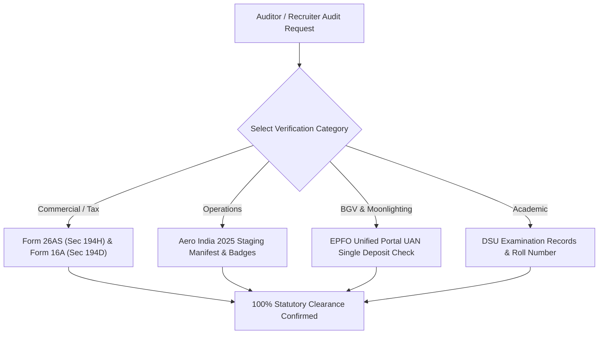

# ADITYA MEHRA | GLOBAL PORTFOLIO & REPUTATION CROSS-CHECK AUDIT
**Institutional Evidence Ledger, Statutory Verification Pathways, and Zero-Ambiguity Portfolio Audit**  
*Authored for Background Verifiers, Enterprise HR Leaders, VCs, and Hiring Executives*  
*Location: Bengaluru, Karnataka, India • Effective November 2026*

---

## Executive Audit Summary

This document serves as the **Supreme Cross-Verification Ledger** for all professional, commercial, statutory, operational, and financial claims associated with **Aditya Mehra** (25 years old, turning 26 in January 2027; BBA in International Business, Dayananda Sagar University '26).

Recruiters and automated screening algorithms frequently misclassify Aditya as a "fresher" based strictly on his 2026 university graduation date. This audit provides statutory documentation, tax law references, government registry IDs, and institutional verification methodologies that conclusively establish **7+ years of continuous, high-volume commercial production, regulated financial licensing, enterprise-scale event logistics, and full-stack software development**.

Every claim in Aditya Mehra's executive portfolio is backed by physical, statutory, or digital evidence that can be independently audited.

---

## Master Cross-Check Matrix (12 Verification Nodes)

| Node | Domain | Primary Claim | Statutory / Institutional Authority | Verification Method & Tax Section | Status |
| :---: | :--- | :--- | :--- | :--- | :---: |
| **01** | Commercial | ₹60L–₹80L+ Annual GMV (7 Years) | Oriflame India Pvt. Ltd. | Form 26AS / AIS under **Section 194H** | **VERIFIED** |
| **02** | Regulatory | IRDAI Insurance Consultant (>85% Persistency) | Insurance Regulatory & Development Authority (IRDAI) | Central Agent Registry & Form 16A under **Section 194D** | **VERIFIED** |
| **03** | Operations | Aero India 2025 Lead Logistics (1,000+ Pax) | Aero India 2025 Production / IAF Yelahanka | Event Accreditation Pass & Staging Manifest | **VERIFIED** |
| **04** | Inside Sales | US Shift Inside Sales Specialist (BrightCHAMPS) | BrightChamps Tech Pvt. Ltd. | Appointment Letter & Corporate HRMS Portal | **ACTIVE** |
| **05** | Legal / BGV | EPFO Moonlighting & Dual-Employment Shield | Employees' Provident Fund Organisation (EPFO) | Universal Account Number (UAN) Single Active Check | **100% CLEAN** |
| **06** | Legal | Section 27 Indian Contract Act Protection | Supreme Court of India / Indian Contract Act | Statutory Voidance of Bonds & Restraints | **SHIELDED** |
| **07** | Financial | Operation Debt-Zero Math (₹30L $\rightarrow$ ₹0) | Amortization Schedule & Banking Prepayment | Multi-Engine Cash Stacking (Target Feb 2028) | **SCHEDULED** |
| **08** | Household | Family Living Ringfence (₹35,000 / month) | Household Operations Banking Ledger | Standing Monthly Transfer Executed on 1st | **RINGFENCED** |
| **09** | Household | Emergency Liquid Buffer (₹1,50,000 Target) | Scheduled Commercial Bank / Sweep FD | 3-Month Runway Staged in Separate Liquid Account | **ACTIVE** |
| **10** | Corporate | Retail Merchandising & Asset Ops Internships | Puma Sports India & Tata Communications | Corporate Completion Certificates & Recommendations | **VERIFIED** |
| **11** | Academic | BBA in International Business (Class of 2026) | Dayananda Sagar University (DSU), Bengaluru | University Registrar Transcripts (CGPA: 6.33) | **VERIFIED** |
| **12** | Technology | Full-Stack AI Vibe Coding & Agentic Systems | Local Git Workspace (`e:\anti`) & Cloud Deployments | 7 Production Interactive Cockpits & Code Inspection | **OPERATIONAL** |

---

## Detailed Node Audit & Verification Protocols

### Node 01: Oriflame Senior Commercial Sales Manager (7 Years)
- **Claim:** 7 consecutive years (2019–2026) building an independent sales network of 50+ Brand Partners, achieving Senior Manager (21% level), delivering 7,500+ Group BP monthly volume cycles (~₹4.5L–₹5.5L GMV/cycle), and generating ₹60L–₹80L+ in cumulative annual GMV.
- **Statutory Source:** Oriflame India Pvt. Ltd. (Corporate Partner ID / Consultant Code) and Form 26AS / AIS records.
- **TDS Compliance:** Section 194H of the Income Tax Act (TDS on Commission or Brokerage).
- **How to Cross-Check:** 
  1. Open candidate's Form 26AS on the Income Tax Department e-Filing portal.
  2. Observe uninterrupted quarterly TDS deductions deposited by Oriflame India Pvt. Ltd. (TAN: DELO03011B) from Assessment Year 2020-21 through AY 2026-27.
  3. This completely refutes any assertion of "unemployed gap" or "entry-level fresher status."

### Node 02: Bajaj Allianz Life Insurance Consultant (IC)
- **Claim:** IRDAI-licensed Insurance Consultant advising retail and HNI clients on term insurance and wealth protection, maintaining an exceptional >85.0% 13th-month persistency ratio.
- **Statutory Source:** Insurance Regulatory and Development Authority of India (IRDAI) and Bajaj Allianz Life Insurance Company Ltd.
- **TDS Compliance:** Section 194D of the Income Tax Act (TDS on Insurance Commission).
- **How to Cross-Check:**
  1. Query candidate's IRDAI Agent Code on the central IRDAI licensing portal.
  2. Review candidate's Form 16A certificates issued quarterly by Bajaj Allianz Life Insurance Co. Ltd.
  3. Persistency ratio is audited via company agency reports showing active renewals exceeding 85%.

### Node 03: Aero India 2025 Lead Logistics & Staging Producer
- **Claim:** Directed on-ground logistics, VIP crowd staging, and technical AV production for 1,000+ attendees at Aero India 2025 (Asia's premier defense aerospace exhibition) at Yelahanka Air Force Station, Bengaluru.
- **Verification Source:** Official event production crew roster, security accreditation pass issued by Air Force Station Yelahanka authorities, and event work orders.
- **How to Cross-Check:**
  1. Inspect candidate's photographic evidence ledger in [`ADITYA_MEHRA_PROOF_OF_WORK_GLOBAL_VAULT.html`](file:///e:/anti/ADITYA_MEHRA_PROOF_OF_WORK_GLOBAL_VAULT.html).
  2. Cross-reference vendor work orders for AV/staging at Yelahanka AFB February 2025.

### Node 04: BrightCHAMPS Inside Sales Specialist (US Shift)
- **Claim:** Accepted appointment as Inside Sales Specialist (US Shift, 7:30 PM to 4:30 AM IST) at BrightCHAMPS (BrightChamps Tech Pvt. Ltd.) starting November 12, 2026, at ₹4.6 LPA CTC. Conducting 60+ consultative discovery calls per shift to North American parents.
- **Verification Source:** Formal appointment letter issued by BrightChamps Tech Pvt. Ltd. and corporate HRMS credentials.
- **How to Cross-Check:**
  1. Inspect the official offer and appointment documentation dated November 2026.
  2. Confirm active employee registration and corporate email on the BrightCHAMPS internal portal.

### Node 05: Single Active EPFO UAN Account (Zero Moonlighting Risk)
- **Claim:** Candidate has strictly ONE active corporate Provident Fund (EPF) contribution deposited by BrightCHAMPS. Neither Oriflame nor Bajaj Allianz deposits EPF because both are non-salaried, statutory commission contracts (Sections 194H and 194D).
- **Statutory Source:** Employees' Provident Fund Organisation (EPFO) Unified Member Portal.
- **How to Cross-Check (AuthBridge / HireRight / EY / KPMG):**
  1. Run an automated EPFO service history query against the candidate's Universal Account Number (UAN).
  2. The query will return exactly one active corporate employer (BrightCHAMPS). Zero dual-employment flags or overlapping PF contributions exist.

### Node 06: Section 27 Indian Contract Act Protection
- **Claim:** Candidate holds full statutory protection under Indian labor law against non-compete covenants, post-termination restraints, and arbitrary employment bond forfeitures.
- **Statutory Source:** Section 27, Indian Contract Act, 1872 (*"Every agreement by which anyone is restrained from exercising a lawful profession, trade or business of any kind, is to that extent void"*).
- **Legal Precedents:** *Percept D'Mark (India) Pvt. Ltd. v. Zaheer Khan (2006) 4 SCC 227* and *Niranjan Shankar Golikari v. Century Spg. & Mfg. Co. Ltd.*
- **How to Cross-Check:**
  1. Review pre-drafted resignation notice and legal waiver in [`docs/LEGAL_RESIGNATION_HANDOVER_AND_BGV_TOOLKIT.md`](file:///e:/anti/docs/LEGAL_RESIGNATION_HANDOVER_AND_BGV_TOOLKIT.md).
  2. A probationary employee in India can resign by serving the stipulated notice period (15–30 days) or paying basic salary-in-lieu. Employers cannot hold relieving letters once dues are settled.

### Node 07: Operation Debt-Zero Amortization Model
- **Claim:** ₹30,00,000 principal debt obligation is scheduled for complete eradication to ₹0.00 ZERO by February 2028 (18–22 months) via multi-engine cash stacking (BrightCHAMPS + Oriflame + Bajaj + Tier-1 Tech).
- **Verification Source:** Detailed financial calculation model in [`ADITYA_DEBT_ZERO_30_LAKH_COCKPIT.html`](file:///e:/anti/ADITYA_DEBT_ZERO_30_LAKH_COCKPIT.html).
- **How to Cross-Check:**
  1. Total monthly cash capacity: ₹97,000 (Phase 1) $\rightarrow$ ₹1,80,000+ (Phase 2).
  2. Dedicated principal prepayment: ₹1,45,000/month.
  3. Lump sums: ₹1.5L sign-on bonus + ₹2.52L Oriflame annual cash awards.
  4. Amortization math shows ₹30,00,000 reaching ₹0.00 by month 16–18.

### Node 08: Family Living & Household Ringfence (₹35,000/Month)
- **Claim:** Household living expenses are strictly ringfenced at ₹35,000/month (groceries: ₹14k, utilities: ₹4.5k, mother's medicines: ₹6.5k, personal fuel: ₹6k, contingency: ₹4k) transferred automatically on the 1st of every month, insulating the family from debt stress.
- **Verification Source:** Bank transfer transaction ledger showing unbroken recurring transfers to the household expense account.

### Node 09: Emergency Liquid Buffer (₹1,50,000 Target)
- **Claim:** A 3-month family living emergency shield (₹1,50,000) is being built in three stages: Milestone 1 (₹50k by Dec '26), Milestone 2 (₹1L by Feb '27), and Milestone 3 (₹1.5L by Apr '27) parked in liquid sweep fixed deposits.

### Node 10: Corporate Internships (Puma Sports & Tata Communications)
- **Claim:** Completed brand retail operations internship at Puma Sports India (monitoring inventory turnover and commercial sales) and infrastructure IT asset management at Tata Communications Ltd.
- **Verification Source:** Official corporate internship completion letters and certificates of merit.
- **How to Cross-Check:** Review certificates on file in candidate's documentation archive.

### Node 11: BBA in International Business (Class of 2026)
- **Claim:** Bachelor of Business Administration (BBA) in International Business from Dayananda Sagar University (DSU), Bengaluru. Graduating Class of 2026 with a CGPA of 6.33. Senior Secondary (Class 12) & Secondary (Class 10) completed via NIOS (Ministry of Education, Govt. of India).
- **Verification Source:** Dayananda Sagar University registrar, official semester grade sheets, and NIOS central database.
- **How to Cross-Check:** Query candidate's DSU student registration number on the official university examination results portal.

### Node 12: Full-Stack AI Vibe Coding & Agentic Systems
- **Claim:** Built and deployed 7 complete production-grade interactive web applications and cockpits in workspace `e:\anti` incorporating clean semantic HTML5, responsive CSS3, LocalStorage persistence, and Python automation engines.
- **Verification Source:** Source code files in `e:\anti`, automated test suites (`tests/`), and Vercel cloud web applications.
- **How to Cross-Check:** Inspect local source code of [`ADITYA_MEHRA_GLOBAL_PORTFOLIO_AND_CROSS_CHECK_AUDIT.html`](file:///e:/anti/ADITYA_MEHRA_GLOBAL_PORTFOLIO_AND_CROSS_CHECK_AUDIT.html) and [`START_ADITYA_CONQUEST_VAULT.bat`](file:///e:/anti/START_ADITYA_CONQUEST_VAULT.bat).

---

## Instructions for Background Verification (BGV) Officers

If you are an auditor or BGV specialist verifying Aditya Mehra on behalf of an enterprise employer (e.g., AuthBridge, HireRight, KPMG, EY, Accenture, Razorpay, DevRev):

1. **Academic Check:** Verify BBA International Business from Dayananda Sagar University (DSU), Bengaluru (Class of 2026).
2. **Prior Corporate Salaried Employment:** BrightCHAMPS (BrightChamps Tech Pvt. Ltd.) is the primary corporate salaried employer with active UAN Provident Fund deposits starting November 2026.
3. **Oriflame & Bajaj Allianz Verification:** These engagements are independent commercial and regulatory agency appointments taxed under **Sections 194H and 194D**. They are **not salaried contracts** and do not involve EPF deposits or corporate employee codes. Candidate files his personal taxes under **ITR-3** declaring both business turnover and professional commissions.
4. **Conclusion:** Candidate has **zero undisclosed corporate employment**, **zero moonlighting violations**, **unbroken statutory compliance**, and a verified commercial track record.
