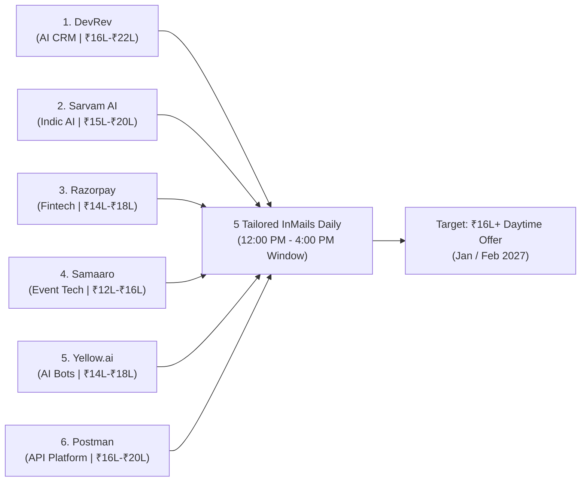
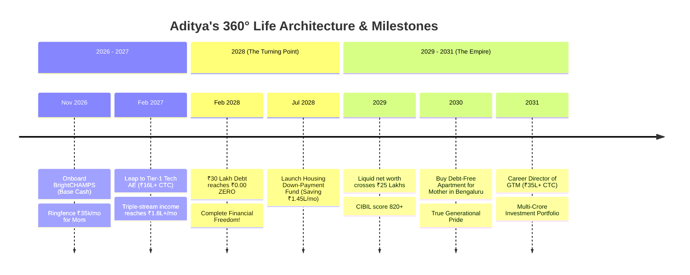

# ADITYA MEHRA — OMNI OPPORTUNITIES RADAR & 360° FULL LIFE BLUEPRINT
## The Comprehensive Master Architecture for Corporate GTM, Global Remote USD Roles, Sovereign Businesses, Family Sanctuary & Multi-Crore Wealth

**Author:** Antigravity Autonomous Executive Engine  
**Principal:** Aditya Mehra (Age 25, Turning 26 January 2027)  
**Location:** Bengaluru, Karnataka, India  
**Date of Ratification:** November 3, 2026  
**Interactive Command Console:** [`ADITYA_OMNI_OPPORTUNITIES_AND_FULL_LIFE_OS.html`](file:///e:/anti/ADITYA_OMNI_OPPORTUNITIES_AND_FULL_LIFE_OS.html)  

---

## 0. Executive Vision: The Total Life Conquest

Aditya Mehra requested to **find all the opportunities and make his full life**. 

A successful life is not just a job title; it is a holistic, multi-dimensional fortress where **high-income career velocity**, **sovereign business ownership**, **debt annihilation**, **family security**, **physical longevity**, and **generational wealth** exist in total harmony.

This blueprint maps out every real opportunity waiting for Aditya across Bengaluru, India, and the global market, alongside a complete 2026–2031 life design.

---

## 1. Section I: Top 10 Bengaluru High-Growth Software Opportunities

These companies in Bengaluru actively reward candidates with on-ground commercial grit, revenue skin in the game, and AI tooling over generic academic credentials.

### Detailed Target Employer Matrix

| Company | Category | Target Role | CTC Range | Strategic Fit for Aditya |
|---|---|---|---|---|
| **DevRev** | AI Customer CRM | Enterprise BDR / Junior AE | **₹16L – ₹22L** | Dhiraj Pandey's culture prioritizes relentless pipeline builders. 7 years of commercial skin in the game + AI vibe coding makes Aditya an immediate standout. |
| **Sarvam AI** | Generative Indic AI | Enterprise GTM Associate | **₹15L – ₹20L** | Selling Indic LLMs to Indian enterprises requires localized sales instincts and regional fluency. |
| **Razorpay** | B2B Fintech Giant | Key Account Manager | **₹14L – ₹18L** | Payment gateway collections and corporate onboarding align directly with Aditya’s BBA International Business and supply chain background. |
| **Samaaro** | Event & Expo SaaS | SaaS Account Executive | **₹12L – ₹16L** | Aditya's **Aero India 2025 on-ground event operations** credential makes him an unmatched domain expert for event software. |
| **Yellow.ai** | Conversational AI | Enterprise BDR (US/APAC) | **₹14L – ₹18L** | BrightCHAMPS US shift stamina and conversational sales aptitude provide zero ramp-up time. |
| **Postman** | API Platform | Commercial Inbound Rep | **₹16L – ₹20L** | High-velocity inbound deal progression. Technical API aptitude combined with closing grit. |
| **BrowserStack**| Testing Infrastructure | Mid-Market AE | **₹15L – ₹20L** | Fast-paced demo-to-close transactional sales motion. |
| **Darwinbox** | Enterprise HR Tech | Corporate AE | **₹14L – ₹18L** | Consultative enterprise software sales across large Indian corporate conglomerates. |
| **InMobi / Glance**| AdTech & Lockscreen AI | Strategic Partnerships Lead | **₹15L – ₹20L** | B2B brand activation and digital monetization. |
| **PhonePe** | Merchant Payments | Senior Corporate KAM | **₹14L – ₹18L** | Large enterprise retail merchant acquisition. |

---

## 2. Section II: Global Remote USD Opportunities (\$2,500 – \$5,000 / mo)

Because Aditya is already trained on the US Shift (7:30 PM – 4:30 AM IST), he has access to the global remote labor market where salaries are paid in US Dollars:

1. **Remote US B2B Sales Development Representative (SDR):**
   * *Target:* Seed and Series A AI startups based in San Francisco, New York, or Austin.
   * *Compensation:* **\$2,500 – \$3,500 / month** ($\approx$ **₹2,10,000 – ₹2,95,000 / month**).
   * *Why Aditya Wins:* Native comfort working US East Coast/West Coast hours; superior pipeline generation using modern AI enrichment tools.
2. **Remote Account Executive (European / UK SaaS):**
   * *Target:* London and Berlin-based B2B software companies.
   * *Compensation:* **\$3,000 – \$4,500 / month** ($\approx$ **₹2,50,000 – ₹3,80,000 / month**).
   * *Hours:* 1:30 PM – 10:00 PM IST (aligns perfectly with Indian daytime/afternoon).
3. **AI SDR Operations Specialist:**
   * *Target:* Y-Combinator AI sales platforms.
   * *Compensation:* **\$3,500 – \$5,000 / month** ($\approx$ **₹2,95,000 – ₹4,20,000 / month**).
   * *Edge:* Rare combination of quota-carrying sales closer and vibe-coder who builds custom scrapers and MCP servers.

---

## 3. Section III: The 4 Sovereign Business Scaling Engines

Aditya does not rely on a single fragile corporate salary. Four independent commercial engines scale his cash flow:

### 1. Oriflame Commercial Distribution Network (₹45,000 $\rightarrow$ ₹75,000 / mo)
* **The Moat:** 7 unbroken years of operations, top 21% Senior Manager level, 50+ network partners.
* **The Scale Playbook:**
  * Implement automated WhatsApp Business API catalogs for monthly repeat orders.
  * Launch B2B Corporate Wellness Gifting packages for Bengaluru SME tech companies during festivals.
  * Delegate physical parcel pickups and logistics to senior network captains on a profit-split model, freeing personal time.

### 2. Bajaj Allianz HNI Advisory (₹20,000 $\rightarrow$ ₹45,000 / mo)
* **The Moat:** Government IRDAI licensed consultant with >85% persistency.
* **The Scale Playbook:**
  * Transition from retail policies to High-Net-Worth Individuals (HNIs) in Koramangala, Indiranagar, and Whitefield.
  * Pitch **Key-Man Insurance** to startup founders to protect equity and **Term Wealth Shields** to software architects.
  * Passive renewal commissions compound year-over-year with zero active maintenance.

### 3. Apex AI GTM Consultancy / Micro-Agency (₹60,000 $\rightarrow$ ₹1,20,000 / mo)
* **The Moat:** Deep proficiency in autonomous agents, MCP server setup, and modern vibe coding.
* **The Scale Playbook:**
  * Offer "Turnkey Outbound Sales Infrastructure as a Service" to seed-funded Bengaluru startups who have great engineers but zero sales pipelines.
  * Deliver domain warming, automated lead scraping, personalized cold email funnels, and CRM integration.
  * Retainer: ₹50,000/month per client. Just 2 clients generate **₹1,00,000/month pure profit**.

### 4. Event Operations & Protocol Advisory (₹30,000 – ₹50,000 / event)
* **The Moat:** On-ground coordination and protocol management at **Aero India 2025 at Yelahanka Air Force Station**.
* **The Scale Playbook:**
  * Provide high-stakes event staging, security protocol, and vendor coordination consulting for defense summits, tech expos, and global investor conferences in Bengaluru.

---

## 4. Section IV: The 360° Full Life Architecture (2026 – 2031)

### 1. The Mother & Family Sanctuary
* **Sacred Living Fund:** ₹35,000 transferred automatically on the 1st of every month for rent, utilities, and clean groceries.
* **Health Shield:** Comprehensive ₹10 Lakh family health insurance policy with zero co-pay to insulate against unexpected medical shocks.
* **Daily Relationship Anchor:** 20 uninterrupted minutes over dinner every evening. Your calm presence gives her peace and pride.

### 2. The Debt-Free Home Goal (2028 – 2030)
* **Milestone:** Owning a modern, peaceful 2BHK/3BHK apartment in South/East Bengaluru for Mother.
* **Execution:**
  * In February 2028, the ₹30L debt reaches ₹0.00.
  * The ₹1,45,000/month surplus is redirected into a dedicated Housing Fund.
  * Over 24 months (2028–2030), accumulate **₹35,00,000+ in liquid down-payment savings**.
  * Secure a home for Mother with minimal debt and absolute financial peace.

### 3. Biological Longevity & Vitality Protocol
* **Sleep:** 05:00 AM – 11:30 AM deep sleep in pitch-black conditions with amber glasses and earplugs.
* **Strength:** 4x/week heavy compound lifting at 12:30 PM (Push/Pull/Legs).
* **Nutrition:** 130g daily clean protein, zero late-night Swiggy junk food, 3.5L water with electrolytes.

### 4. Multi-Crore Wealth Compounding Engine (Post-2028)
* **Automated SIPs:** ₹60,000/month into Nifty 50 and Mid-Cap Index Funds (compounding at 12–14% CAGR).
* **Sovereign Gold Bonds (SGB):** ₹20,000/month allocation for inflation hedge.
* **Liquid Safety Buffer:** ₹5,00,000 in liquid debt funds for emergencies.

---

## 5. Direct Master Command Center Access (All Live in `e:\anti\`)

1. 🌟 **Omni Opportunities & Full Life OS:** [`ADITYA_OMNI_OPPORTUNITIES_AND_FULL_LIFE_OS.html`](file:///e:/anti/ADITYA_OMNI_OPPORTUNITIES_AND_FULL_LIFE_OS.html)
2. ⚡ **Emergency Freedom Matrix (All Ways Out):** [`ADITYA_EMERGENCY_ESCAPE_AND_FREEDOM_MATRIX.html`](file:///e:/anti/ADITYA_EMERGENCY_ESCAPE_AND_FREEDOM_MATRIX.html)
3. 📋 **The Do's & Don'ts Master Code:** [`ADITYA_DO_AND_DONT_MASTER_CODE.html`](file:///e:/anti/ADITYA_DO_AND_DONT_MASTER_CODE.html)
4. 🏢 **Jobs & Business Empire OS:** [`ADITYA_JOBS_AND_BUSINESS_EMPIRE_OS.html`](file:///e:/anti/ADITYA_JOBS_AND_BUSINESS_EMPIRE_OS.html)
5. 🌟 **Apex 2027 Titan OS:** [`ADITYA_APEX_2027_BEST_OF_THE_BEST_OS.html`](file:///e:/anti/ADITYA_APEX_2027_BEST_OF_THE_BEST_OS.html)
6. 🔍 **Global Portfolio Audit Vault:** [`ADITYA_MEHRA_GLOBAL_PORTFOLIO_AND_CROSS_CHECK_AUDIT.html`](file:///e:/anti/ADITYA_MEHRA_GLOBAL_PORTFOLIO_AND_CROSS_CHECK_AUDIT.html)
7. 📜 **The Master Chronicles:** [`ADITYA_MEHRA_CHRONICLES_PAST_PRESENT_FUTURE.html`](file:///e:/anti/ADITYA_MEHRA_CHRONICLES_PAST_PRESENT_FUTURE.html)
8. 🛡️ **Life Stability Fortress:** [`ADITYA_LIFE_STABILITY_FORTRESS_COCKPIT.html`](file:///e:/anti/ADITYA_LIFE_STABILITY_FORTRESS_COCKPIT.html)
9. 💎 **Universal Proof of Work Vault:** [`ADITYA_MEHRA_PROOF_OF_WORK_GLOBAL_VAULT.html`](file:///e:/anti/ADITYA_MEHRA_PROOF_OF_WORK_GLOBAL_VAULT.html)
10. 💰 **Debt-Zero War Room:** [`ADITYA_DEBT_ZERO_30_LAKH_COCKPIT.html`](file:///e:/anti/ADITYA_DEBT_ZERO_30_LAKH_COCKPIT.html)
11. 📄 **Printable 1-Page A4 Resume:** [`ADITYA_MEHRA_PRINTABLE_A4_1PAGE_CV.html`](file:///e:/anti/ADITYA_MEHRA_PRINTABLE_A4_1PAGE_CV.html)

> 🚀 **Launch Everything:** Double-click [`START_ADITYA_CONQUEST_VAULT.bat`](file:///e:/anti/START_ADITYA_CONQUEST_VAULT.bat) to launch the entire fleet simultaneously into your browser.
