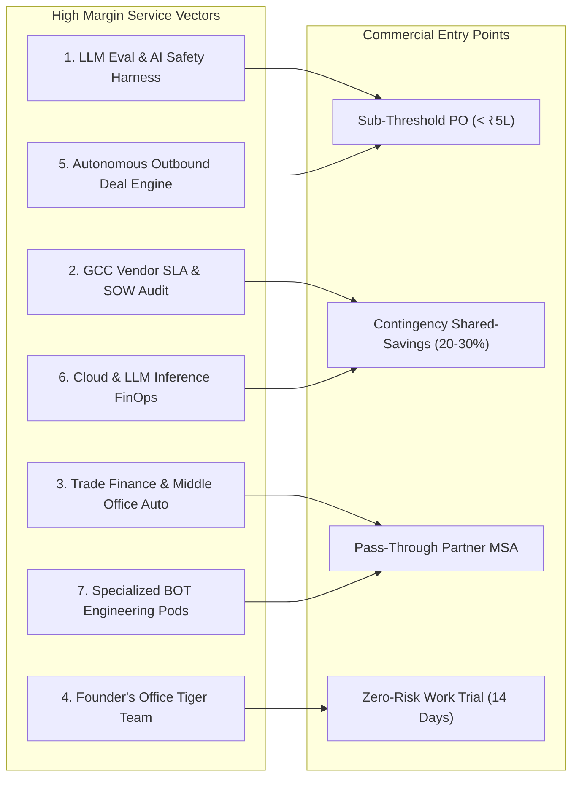
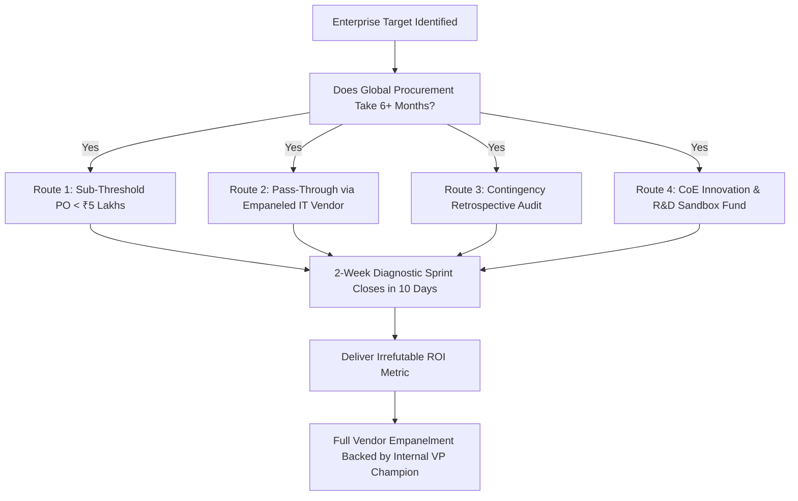

# BENGALURU ENTERPRISE & UNICORN REVENUE ENGINE: MASTER COMMERCIAL OPERATIONAL BLUEPRINT

**High-Ticket Deal Structuring, Procurement Bypasses, Turnkey Projects, and Retainer Systems for Fortune 500 GCCs and Elite Tech Startups**

---

## 1. The Macro Opportunity in Bengaluru

Bengaluru is the undisputed Silicon Valley and Global Capability Center (GCC) capital of Asia. With over 670+ established Fortune 500 GCCs and over 40+ unicorns concentrated within a 25-kilometer radius (Outer Ring Road, Whitefield, Electronic City, Koramangala, Indiranagar, Manyata Embassy Tech Park), the city concentrates more enterprise software procurement and operational spending than any other hub in the Global South.

### The Two Core Engines of Spend:
1. **Fortune 500 Global Capability Centers (GCCs):**
   - Annual tech and operational budget per center: **$50 Million to $500 Million**.
   - Evolution: Transitioning from cost-center support into global product innovation, cloud engineering, automated trade operations, and enterprise AI transformation.
   - Core Bottleneck: Massive bureaucratic inertia, vendor SLA leakages, global procurement gridlock, and risk-aversion around GenAI deployments.
2. **Bengaluru Tech Unicorns & Startups:**
   - Operational reality: High venture capital and revenue velocity, aggressive unit-economics targets, intense competition, and urgent engineering milestones.
   - Core Bottleneck: High cloud/AI inference burn, talent bottlenecks in specialized domains (AI infra, latency optimization), and bandwidth deficits in executive Founder's Offices.

---

## 2. Seven Concrete High-Margin Monetization Models

---

### Detailed Mechanics of Each Model:

### 1. Enterprise AI Evaluation, Adversarial Red-Teaming & Guardrail Harnesses
- **The Problem:** Fortune 500 GCCs (Walmart Global Tech, Target, Cisco, Wells Fargo) have built internal LLM prototypes, but their Global Risk and InfoSec teams refuse to let them go to production due to prompt injections, hallucinations, PII leakage, and non-compliance with the EU AI Act or RBI AI guidelines.
- **The Solution:** Deliver an automated **LLM Evaluation & Guardrails Harness**. It runs 20,000+ domain-specific test prompts against their LLM application (RAG systems, internal search, automated support, code generation) to verify correctness, hallucination rate, and adversarial safety.
- **Pricing:**
  - Initial 2-week Eval Benchmark & Audit: **₹6,50,000 to ₹12,00,000 ($8k–$15k)**.
  - Ongoing CI/CD Regression Retainer: **₹3,00,000 to ₹6,00,000/month**.

### 2. GCC Vendor SLA & SOW Leakage Audit & Recovery
- **The Problem:** Fortune 500 GCCs outsource hundreds of software developers from Indian IT vendors (Infosys, TCS, Wipro, LTIMindtree, boutique staffing firms). In multi-million dollar annual vendor contracts, 8% to 15% is leaked via uncredited SLA breaches, ghost hours, unbilled bench roll-offs, and duplicate billing.
- **The Solution:** A retrospective audit engine that reconciles Jira git activity, timesheet submissions, and SOW milestone deliverables to uncover unearned billings and recover contractual penalty credits.
- **Pricing:**
  - Base Audit Fee: **₹5,00,000 ($6,000)** (covered under single-quote discretionary spend).
  - Contingency Success Fee: **15% to 25% of all recovered cash credits or vendor discounts** (often generating ₹30L to ₹1.5 Cr in net revenue).

### 3. Trade Finance & FinTech Middle-Office Settlement Engine
- **The Problem:** Global investment banks and financial GCCs in Bangalore (Goldman Sachs GSC, JPMorgan Chase India, Standard Chartered GBS, Deutsche Bank CIB) examine documentary credits under ICC UCP 600 rules. Examining a single Letter of Credit (LC) and accompanying Bills of Lading, Invoices, and Inspection Certificates takes 2 to 4 hours per transaction, with high human error rates.
- **The Solution:** An automated document verification module that ingests PDF/scanned trade documents and validates 100+ compliance checks under UCP 600 and ISBP 745 in under 45 seconds.
- **Pricing:**
  - Deployment & Workflow Customization: **₹40,00,000 to ₹75,00,000 ($48k–$90k)**.
  - Annual Maintenance Contract (AMC): **20% annually**.

### 4. Founder's Office & CXO "Tiger Team" on Demand
- **The Problem:** Bangalore unicorn founders and Series B/C CEOs (CRED, Zepto, Ather Energy, Swiggy, Meesho) constantly encounter high-stakes operational fires: launching a pilot dark store network, restructuring logistics unit economics, compiling an investor syndicate data-room, or untangling a failing business unit. Full-time VP hiring takes 90–120 days.
- **The Solution:** An elite, 2-to-3 person "Special Projects Tiger Team" that embeds inside the Founder's Office for a 30 to 60 day sprint to take ownership of the bottleneck, execute daily triage, build models, and deliver resolved operational reality.
- **Pricing:**
  - Monthly Retainer: **₹5,00,000 to ₹12,00,000/month ($6k–$14.5k/mo)** + performance bonus or advisory equity.

### 5. Autonomous Outbound Deal Engine & Enterprise Pipeline Infrastructure
- **The Problem:** Fast-growing B2B tech companies (Postman, BrowserStack, Hasura, enterprise startups) burn huge budgets on manual SDR teams that produce low conversion rates, spam high-value enterprise accounts, and fail to secure meetings with Fortune 500 VP-level decision makers.
- **The Solution:** Build and deploy an Autonomous B2B Outbound Engine: scrapers monitoring technographic hiring signals, automated personalization models crafting deep technical teardowns, and multi-channel delivery across executive LinkedIn and email domains.
- **Pricing:**
  - Setup & Custom Data Pipeline: **₹4,50,000 to ₹8,00,000**.
  - Performance Incentive: **₹30,000 to ₹60,000 per qualified, completed Fortune 500 VP/Director discovery call**.

### 6. Cloud & LLM FinOps (Compute and Inference Cost Arbitrage)
- **The Problem:** Scaleups processing millions of API calls to OpenAI/Anthropic or running GPU clusters on AWS/GCP are suffering from gross margin compression.
- **The Solution:** Implement semantic response caching (Redis/Qdrant), speculative decoding, prompt token compression, and transition from general LLMs to fine-tuned small language models (SLMs) running on optimized inference runtimes (vLLM, TensorRT-LLM).
- **Pricing:**
  - Pure Contingency: **30% of verified cloud/token dollar savings over 12 months**.
  - Or Fixed Retainer: **₹15,00,000 to ₹25,00,000**.

### 7. Specialized Engineering Pods via Build-Operate-Transfer (BOT)
- **The Problem:** Global companies setting up or expanding capability hubs in Bangalore cannot recruit niche technical talent (Distributed Systems, Rust, CUDA, Kubernetes operators) fast enough through conventional staffing agencies.
- **The Solution:** Deploy pre-assembled, senior engineering pods (3–5 engineers) that ship production features immediately under a Build-Operate-Transfer contract, allowing the client to formally absorb them after 12 months.
- **Pricing:**
  - Monthly Billing: **₹18,00,000 to ₹40,00,000/month**.
  - Transfer Fee: **12% to 15% of annual CTC at 12-month absorption**.

---

## 3. The 4 Procurement Bypass Protocols: Cracking the Enterprise Citadel

1. **The Sub-Threshold Discretionary PO Hack:**
   - In most Fortune 500 GCCs (e.g., Walmart, Cisco, Target), Directors and Senior Directors hold discretionary spending authority up to **₹5,00,000 ($6,000)** that requires only a single quote and departmental sign-off.
   - Price your initial diagnostic engagement at **₹4,85,000**. Deliver an audit that uncovers ₹50,00,000+ in waste. The VP then uses that discovered capital to fund your multi-crore full-scale contract.
2. **The Tier-1 Empaneled Pass-Through Partner:**
   - Instead of waiting 9 months to complete master vendor registration, partner with an already-empaneled Tier-1 vendor (such as TeamLease, Innova Solutions, Quess Corp, or a mid-tier IT supplier).
   - The Fortune 500 GCC issues the SOW under the existing partner's Master Services Agreement (MSA); the partner pays you with an agreed 8–10% administrative pass-through cut.
3. **The Contingency Retrospective Audit:**
   - Offer the audit with zero upfront risk: *"We analyze last year's vendor or cloud invoices. If we find less than ₹25 Lakhs in recoverable discrepancies, you pay ₹0. If we identify and recover cash, our fee is 20%."* Procurement cannot block a cash-inflow project that requires zero capital outlay.
4. **The Innovation Sandbox Grant:**
   - GCCs have dedicated "Innovation CoE" or "Incubation" budgets intended for exploring cutting-edge technology (AI, automation). These budgets bypass normal IT procurement committees and are approved by the Bangalore Site Head or VP of Innovation.

---

## 4. Cold Outreach Master Sequences

### Sequence 1: Target - VP of Operations / IT Procurement (Fortune 500 GCC)
- **Subject:** Unbilled SLA credits across Bengaluru IT vendor pods
- **Body:**
> Hi [First Name],
>
> Noticed your team is scaling the [Cloud / Data / Platform] engineering clusters in [Tech Park Name, e.g. Ecospace / Manyata].
>
> In reviewing Tier-1 vendor MSAs across Bengaluru GCCs, between 8% and 14% of contracted spend regularly leaks through uncredited SLA breach penalties, phantom bench downtime, and unmonitored ticket rollovers.
>
> We built an automated audit harness that reconciles Jira delivery logs against monthly vendor timesheets to identify unearned billing in 14 days. We recently surfaced ₹1.2 Cr in uncredited vendor penalties for an enterprise center in Bellandur without altering active project timelines.
>
> Could I send you a 1-page sample audit framework or run a retrospective analysis on past vendor invoices?
>
> Best regards,  
> [Your Name]  
> [Contact]

---

### Sequence 2: Target - Founder / CTO (Bengaluru Tech Unicorn)
- **Subject:** Dropping [Company Name]'s LLM token bills by 40% (p99 latency <100ms)
- **Body:**
> Hi [First Name],
>
> Loved the rollout of [Feature / AI workflow].
>
> Most scaling platforms in Bengaluru processing 500k+ daily LLM queries are burning substantial cash on OpenAI/Anthropic APIs because 30-45% of user prompts trigger repeated semantic patterns and unquantized model calls.
>
> We deploy semantic caching layers and compact quantized models (vLLM / TensorRT) that cut API spend by 35-50% while holding p99 latency under 100ms.
>
> We are happy to run a 48-hour pilot on a single non-critical endpoint on a pure contingency basis: if we don't document 30%+ cost reduction, there is zero fee.
>
> Open to seeing the benchmark data from our last sprint?
>
> Best,  
> [Your Name]  
> [Contact]

---

## 5. Regulatory, Tax & Legal Architecture in Bengaluru

To invoice Fortune 500 GCCs and Indian tech startups without compliance snags:

1. **Entity Incorporation:**
   - Register a **Private Limited Company (Pvt Ltd)** or **Limited Liability Partnership (LLP)** under the Ministry of Corporate Affairs (MCA).
2. **Goods and Services Tax (GST):**
   - Obtain a GSTIN in Karnataka (State Code: `29`).
   - Use HSN/SAC Code:
     - `998313`: Information Technology (IT) consulting and support services.
     - `998314`: Information Technology (IT) design and development services.
     - `998311`: Management consulting services.
3. **Export of Services (Zero-Rated GST) for Foreign Invoicing:**
   - If billing the US or European parent entity of a Bangalore GCC directly in foreign currency (USD, EUR, GBP):
     - Submit a **Letter of Undertaking (LUT)** on the GST portal before executing cross-border invoices. This enables 0% GST invoicing without paying IGST upfront.
     - Secure a **Foreign Inward Remittance Certificate (FIRC)** or Foreign Inward Remittance Advice (FIRA) from your bank for every overseas wire, satisfying RBI FEMA export documentation.
4. **Supplies to Special Economic Zones (SEZs):**
   - Many GCC campuses in Bangalore (e.g. Cessna Business Park, Global Village, Pritech Park) are designated SEZ units.
   - Supplies of services to an SEZ unit are treated as zero-rated under Section 16 of the IGST Act. Ensure the client provides an SEZ Endorsement / Form I from the SEZ Development Commissioner to qualify for 0% GST.
5. **Contract Terms & Payment Milestones:**
   - Avoid standard Net-90 or Net-120 enterprise payment cycles.
   - Enforce milestone-based billing:
     * **30% Advance** upon SOW signing (mobilization fee).
     * **40% Delivery Milestone** upon sandbox demonstration or interim audit presentation.
     * **30% Final Sign-Off** upon delivery of final code/audit documentation (Net-15 terms).
