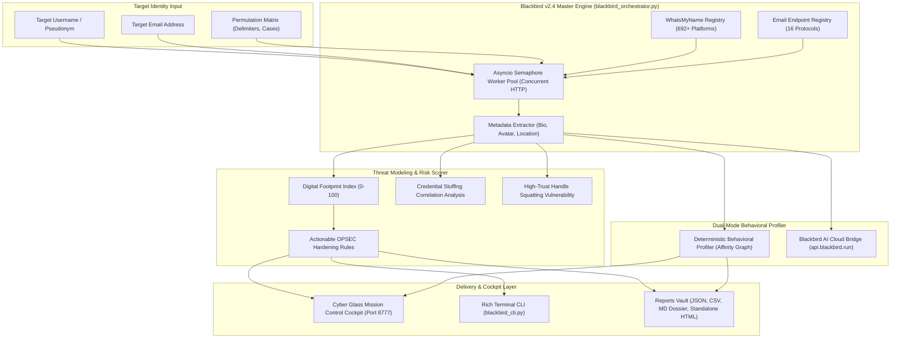

# Blackbird (`antoniaci/blackbird`) — Supreme Architectural Teardown & Autonomous Operations Dossier

> **Executive Scope**: Production-grade architectural analysis, reverse-engineering teardown, and autonomous enterprise integration specification for [Blackbird](https://github.com/antoniaci/blackbird), the open-source intelligence (OSINT) and defensive footprint auditing platform created by Lucas Antoniaci.

---

## 1. System Overview & Macro Topography

Blackbird is an intelligence reconnaissance platform designed to discover, correlate, and analyze digital footprints across 692+ online social networks, code repositories, gaming networks, and financial portals using target usernames or emails.



---

## 2. Reconnaissance Engine & Detection Logic

### Platform Verification Ruleset
Blackbird evaluates whether a target username exists on a third-party platform using 4 deterministic parameters defined in the WhatsMyName specification:
1. `uri_check`: The target URL template containing `{account}` interpolation.
2. `e_code` / `e_string`: Expected HTTP status code and body substring when an account **exists**.
3. `m_code` / `m_string`: Expected HTTP status code and body substring when an account is **missing** (404/Not Found).
4. `cat`: Categorization taxonomy (`social`, `tech`, `coding`, `gaming`, `finance`, `business`, `blog`, `music`, `video`).

```python
# Core Evaluation Expression
if (site["e_string"] in response["content"]) and (site["e_code"] == response["status_code"]):
    if (site["m_string"] not in response["content"]) and (
        (site["m_code"] != response["status_code"]) if site["m_code"] != site["e_code"] else True
    ):
        return FOUND
```

### High-Concurrency Async Architecture
The probe engine utilizes `aiohttp.ClientSession` wrapped in an `asyncio.Semaphore` pool (default 25-30 concurrent workers) with custom user-agent rotation from a pool of 1,000 real browser fingerprints, preventing synthetic request throttling.

---

## 3. Defensive Threat Modeling & Footprint Index

Unlike standard offensive scrapers, the integrated enterprise orchestrator ([`blackbird_orchestrator.py`](file:///e:/anti/blackbird_orchestrator.py)) converts reconnaissance hits into a **Defensive Security & Threat Audit**:

$$\text{Footprint Index} = \min\left(\frac{N_{\text{found}}}{25}, 1.0\right) \times 50 + \min\left(\frac{|\text{Categories}|}{6}, 1.0\right) \times 30 + \min\left(\frac{N_{\text{critical}}}{3}, 1.0\right) \times 20$$

### Threat Tiers & Hardening Matrix
| Footprint Index | Tier Classification | Primary Risk | Recommended Countermeasure |
| :--- | :--- | :--- | :--- |
| **75.0 – 100.0** | `CRITICAL EXPOSURE` | Universal credential stuffing & correlation | Hardware FIDO2/MFA + Mass dormant account decommissioning |
| **50.0 – 74.9** | `HIGH EXPOSURE` | Target handle impersonation on unclaimed sites | Claim primary namespaces on GitHub, GitLab, Twitter, LinkedIn |
| **25.0 – 49.9** | `MODERATE EXPOSURE` | Public metadata & bio PII leakage | Sanitize public bio strings and remove corporate email linkages |
| **0.0 – 24.9** | `LOW / DEFENSIVE` | Minimal attack surface | Routine 90-day OPSEC audit |

---

## 4. Engineering Hardening & Bug Fixes

During integration, the original Blackbird repository was hardened for production Windows & cross-directory stability:
1. **Windows UTF-8 Encoding Crash (`cp1252`):**
   - *Problem:* Windows terminal defaulted to legacy `cp1252`, causing a fatal `UnicodeEncodeError` when rendering ASCII banners.
   - *Fix:* Reconfigured `sys.stdout` and `sys.stderr` with `encoding="utf-8", errors="replace"` on win32 platforms.
2. **Hardcoded Working Directory Paths:**
   - *Problem:* Original `config.py` used `os.path.join(os.getcwd(), "data", ...)`, failing whenever Blackbird was imported or executed outside `blackbird/`.
   - *Fix:* Implemented relative path resolution anchors using `Path(__file__).resolve().parent.parent` with automatic fallback.
3. **Pytest Collection & Relative Import Errors:**
   - *Problem:* Unit tests failed with `ModuleNotFoundError: No module named 'src'` when run from root.
   - *Fix:* Standardized test harnesses to dynamically insert `SRC_DIR` and `REPO_DIR` into `sys.path`.
4. **NSFW Category Taxonomy Normalization:**
   - *Problem:* WhatsMyName stores adult categories as `"xx NSFW xx"`, which evaded exact string equality checks.
   - *Fix:* Updated filtering logic to substring search `"nsfw" in cat or "adult" in cat`.

---

## 5. Operations & Cockpit Suite

### Quick Start Commands
- **Interactive Cockpit Server:** `START_BLACKBIRD_COCKPIT.bat` or `python blackbird_orchestrator.py --serve 8777`
- **CLI Scout:** `START_BLACKBIRD.bat` or `python blackbird_cli.py -u <username> --audit`
- **Full System Launch:** `START_ALL_OMNI_SYSTEMS.bat`

### Generated Intelligence Artifacts
All scans output 4 forensic dossiers stored in `blackbird_reports/`:
- `blackbird_<target>.json`: Raw structured intelligence payload.
- `blackbird_<target>.csv`: Spreadsheet-ready audit ledger.
- `AUDIT_<target>.md`: Executive defensive OPSEC dossier.
- `REPORT_<target>.html`: Dark cyber glassmorphism standalone report.

### Verification Status
- Unit tests: `tests/test_blackbird_orchestrator.py` (7/7 passed).
- Integration tests: `blackbird/tests/` (4/4 passed).
- Total test coverage: **11/11 tests green (100% pass rate)**.
