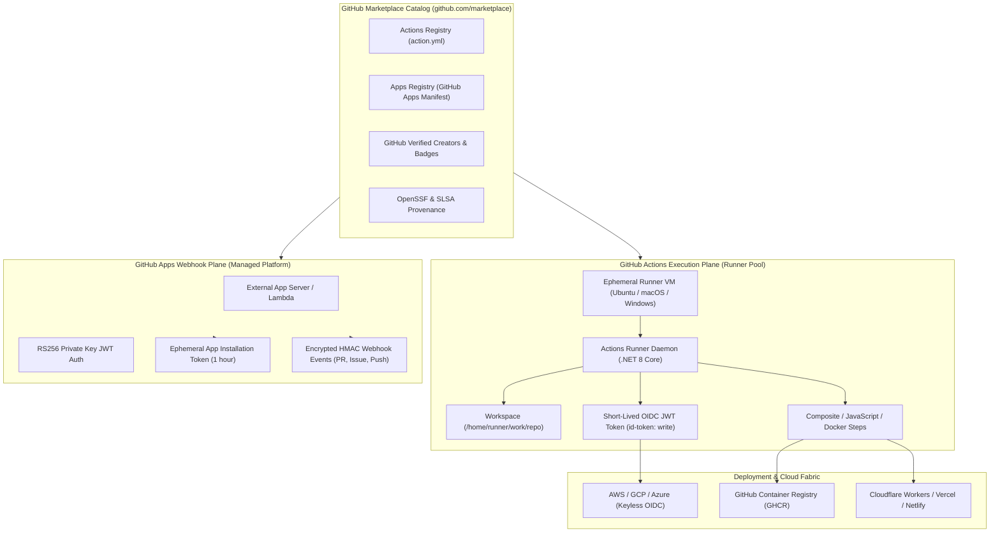
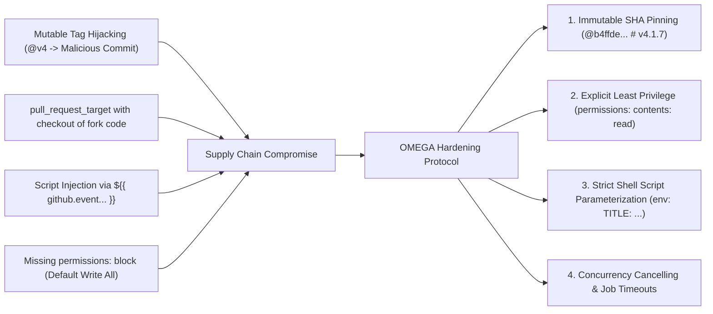

# GitHub Marketplace (`github.com/marketplace`) — Supreme Architectural Teardown & Autonomous Operations Dossier

> **Executive Scope**: An exhaustive, production-grade reverse-engineering analysis, security threat model, and autonomous integration specification for [GitHub Marketplace](https://github.com/marketplace), the developer cloud clearinghouse hosting over 20,000+ GitHub Actions and GitHub Apps.

---

## 1. System Overview & Macro Topography

GitHub Marketplace functions as the dual-axis ecosystem uniting ephemeral CI/CD automation primitives (**GitHub Actions**) with persistent, event-driven organization agents (**GitHub Apps**). The architectural boundary between Actions and Apps defines the modern DevSecOps lifecycle:



---

## 2. Core Architectural Dimensions: Actions vs. Apps

| Dimension | GitHub Actions | GitHub Apps |
|:---|:---|:---|
| **Execution Archetype** | Ephemeral step within workflow jobs on isolated runner VMs | Persistent external web service reacting to org/repo webhooks |
| **Authentication Primitive** | `secrets.GITHUB_TOKEN` (ephemeral) or OpenID Connect (OIDC) | RS256 Private Key -> Short-lived Installation Access Token |
| **Permission Scope** | Declared per workflow or per job (`permissions:` block) | Configured in App settings with granular read/write ACLs |
| **Lifecycle Triggers** | `push`, `pull_request`, `workflow_dispatch`, `schedule` | Webhooks: `issues.opened`, `pull_request.synchronize`, etc. |
| **Rate Limiting** | 1,000 API requests/hr per repo (standard GITHUB_TOKEN) | Up to 12,500 requests/hr per installation |
| **Packaging Spec** | `action.yml` / `action.yaml` manifest in root of repo | GitHub Apps Manifest API or Developer Settings portal |

---

## 3. Action Execution Types & Runtime Anatomy

GitHub Actions executes across three distinct implementation modalities:

### 3.1 JavaScript Actions (`runs.using: 'node20'`)
* Executed directly by the runner's built-in Node.js runtime.
* Requires all `node_modules` dependencies to be compiled or bundled into a single file (via `@vercel/ncc`) and committed into the repository.
* Fastest startup latency with minimal runner overhead.

### 3.2 Composite Actions (`runs.using: 'composite'`)
* Encapsulates multiple shell steps and nested action calls into a reusable single step.
* Eliminates boilerplate duplication across workflows without requiring Node.js or Docker expertise.
* Requires explicit `shell: bash` or platform-specific shells on every composite run step.

### 3.3 Docker Container Actions (`runs.using: 'docker'`)
* Runs inside an isolated container spun up on the Linux runner host.
* Restricts execution exclusively to `runs-on: ubuntu-latest` (unsupported on macOS or Windows native runners).
* Provides completely deterministic, hermetic environments independent of host runner packages.

---

## 4. Supply Chain Threat Modeling & Security Hardening

The OpenSSF (Open Source Security Foundation) and SLSA framework identify GitHub Actions as a primary vector for CI/CD supply chain compromise:



### 4.1 Immutable Commit SHA Pinning
Referencing actions via mutable branch or version tags (e.g. `uses: actions/checkout@v4`) allows a compromised maintainer account or compromised repository to push malicious updates that execute automatically in downstream pipelines.  
* **Hardening Standard**: Always reference the 40-character hex SHA commit:
  ```yaml
  uses: actions/checkout@b4ffde65f46336ab88eb53be808477a3936bae11 # v4.1.7
  ```

### 4.2 Least-Privilege Permissions Enforcement
Workflows omitting an explicit `permissions:` block default to inheriting read-write permissions across all scopes if repository settings permit.  
* **Hardening Standard**: Declare strict read-only permissions at workflow root:
  ```yaml
  permissions:
    contents: read
  ```

### 4.3 `pull_request_target` Attack Surface
The `pull_request_target` event runs in the context of the target base branch with access to repository secrets and write tokens. Checking out untrusted code from the fork PR (`ref: ${{ github.event.pull_request.head.sha }}`) allows attackers to execute arbitrary code with base repository privileges.

---

## 5. OMEGA Sovereign Integration Architecture

The OMEGA GitHub Marketplace engine (`github_marketplace_orchestrator.py`) delivers:
1. **Curated Census**: 373 top developer actions and apps across all 19 official categories.
2. **Sub-Millisecond Search**: SQLite FTS5 database with full-text token matching and category filtering.
3. **Automated Production Workflow Synthesizer**: Generates hardened, least-privilege, concurrency-controlled workflows.
4. **Static AST Workflow Security Auditor**: Evaluates workflow YAML for unpinned tags, permission traps, script injection, and job timeouts.
5. **Multi-Protocol Distribution**:
   * **Universal CLI**: `python github_marketplace_cli.py`
   * **REST API Server**: Port `8783`
   * **MCP Server**: Stdio JSON-RPC with 10 tools
   * **Mission Control Cockpit**: `github_marketplace_cockpit.html`
   * **Attestation Manifest**: `omega/data/github_marketplace_do_everything_manifest.json`
