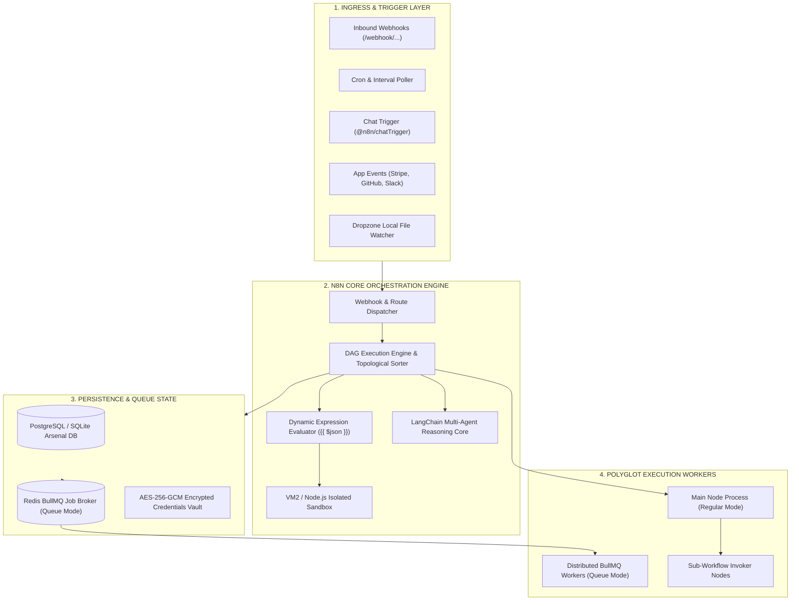
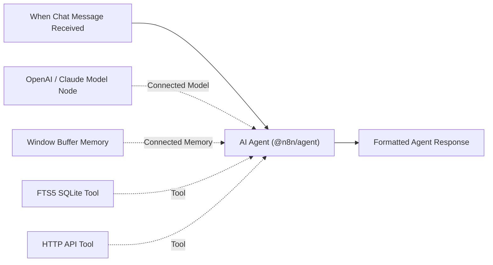

# n8n (`n8n-io/n8n`) — Supreme Architectural Teardown & Autonomous Operations Dossier

> **Executive Scope**: An exhaustive, production-grade reverse-engineering analysis and autonomous integration specification for [n8n](https://github.com/n8n-io/n8n), the premier fair-code workflow automation and AI agent orchestration platform.

---

## 1. Executive Summary & Paradigm Shift

n8n is a distributed workflow automation platform that bridges visual low-code development with Turing-complete code extensibility and native multi-agent generative AI. Unlike traditional rigid integration tools (Zapier, Make) or pure code DAG orchestrators (Airflow, Prefect, Temporal), n8n operates on an event-driven, node-based Directed Acyclic Graph (DAG) architecture where each step passes arrays of JSON and binary records through strongly-typed execution nodes.



---

## 2. Monorepo Architecture & Internal Packages

n8n is organized as a pnpm workspace monorepo under `packages/`:

| Package Namespace | Role & Subsystem Capabilities |
| :--- | :--- |
| `packages/cli` | Main entry point; starts the HTTP/WebSocket Express server, CLI commands, and worker daemons. |
| `packages/core` | Workflow execution runtime, DAG dependency resolution, execution engine, active execution manager. |
| `packages/nodes-base` | 560+ first-party integration nodes (databases, cloud SDKs, enterprise CRMs, protocols). |
| `packages/@n8n/agents` | Autonomous agent runtime, plan-and-solve execution frameworks, tool calling protocol. |
| `packages/@n8n/n8n-nodes-langchain` | LangChain integration nodes: Agent, LM Chat Models, Vector Stores, Memory, Tools. |
| `packages/editor-ui` | Vue.js 3 frontend; interactive node graph canvas, parameter panels, live execution visualizer. |
| `packages/workflow` | Core interfaces, node parameter schemas, data validation, serialization helpers. |
| `packages/task-runner` | Out-of-process isolation runner for executing custom JavaScript/Python code safely. |

---

## 3. The Execution Cycle & Data Flow Mechanics

### 3.1 Data Structure Invariant: `INodeExecutionData[][]`
All nodes in n8n adhere to a strict invariant: data entering and leaving any node is an array of objects containing a `json` field (and an optional `binary` field):
```typescript
interface INodeExecutionData {
  json: IDataObject;
  binary?: IBinaryKeyData;
  pairedItem?: IPairedItemData;
}
```
This design enables seamless 1-to-many, many-to-1, and 1-to-1 processing across disparate enterprise APIs without schema translation friction.

### 3.2 Topological Graph Traversal
1. **Trigger Activation**: An incoming event (webhook POST or scheduled interval) creates an execution record with status `RUNNING`.
2. **Dependency Resolution**: The Core Engine traverses the `connections` object, resolving nodes in topological order.
3. **Expression Evaluation**: Any field with `{{ ... }}` syntax is dynamically evaluated against the current node's input, environment variables, or historical node outputs (`$node["NodeName"].json["key"]`).
4. **Error Handling & Retry**: Nodes can specify `continueOnFail`, automated exponential backoff retries, or routing to dedicated error trigger workflows.

---

## 4. LangChain AI Agent Architecture (`@n8n/n8n-nodes-langchain`)

n8n natively integrates LangChain components directly onto the visual canvas. Unlike black-box AI tools, n8n treats AI components as first-class connected nodes:



### Key AI Agent Capabilities:
- **Autonomous Multi-Step Reasoning**: Implements ReAct (Reason + Act) loops where the LLM evaluates the prompt, chooses an appropriate tool, inspects the tool output, and loops until the answer is complete.
- **Dynamic Tool Binding**: Any standard n8n node or custom workflow can be transformed into an AI agent tool via the Custom Tool node.
- **Memory Windowing**: Maintains conversational state across turns using Redis, PostgreSQL, or in-memory window buffers.

---

## 5. Enterprise Scaling: Regular Mode vs Queue Mode

n8n provides two operational scaling paradigms:

### Regular Mode (Single Process)
- Webhook receiver, execution engine, UI server, and cron scheduler run in a single Node.js process.
- Suitable for small-to-medium deployments (up to 50 concurrent executions).

### Queue Mode (Distributed BullMQ Cluster)
- **Main Server**: Dedicated to UI, REST API, webhook routing, and enqueueing jobs into Redis.
- **Redis BullMQ**: High-throughput distributed job broker tracking job state, concurrency, and delayed retries.
- **Worker Pool**: Headless worker processes (`n8n worker`) scale horizontally across Docker Swarm / Kubernetes to pull and execute jobs in parallel.
- **Webhook Scaling**: Dedicated webhook processor instances (`n8n webhook`) run behind a reverse proxy (Traefik / Nginx) to handle bursts of 10,000+ webhooks/second.

---

## 6. Enterprise Security & Credential Vault

1. **AES-256-GCM Encryption**: All credentials (API tokens, private keys, database passwords) are encrypted at rest using an encryption key (`N8N_ENCRYPTION_KEY`). Secrets are never returned over the REST API or UI.
2. **Code Execution Sandboxing**: Custom Python and JavaScript code nodes run in isolated sandboxed contexts with strictly bounded access to the Node.js global environment.
3. **Role-Based Access Control (RBAC)**: Enterprise tiers support instance-level permissions, workspace isolation, and single sign-on (SAML / OIDC).

---

## 7. Comparative Architectural Matrix

| Dimension | **n8n Platform** | **Windmill Engine** | **Apache Airflow** | **Zapier / Make** |
| :--- | :--- | :--- | :--- | :--- |
| **Backend Core** | TypeScript / Node.js 20+ | Rust Native Core | Python 3 | Proprietary SaaS |
| **Integration Nodes** | **560+ First-Party Nodes** | Polyglot Scripts & Hub | Airflow Providers | SaaS Connectors |
| **AI Agent Support** | **Native LangChain Canvas** | Python AI Scripts | External LLM Operators | Simple AI Steps |
| **Execution Latency** | ~5ms – 25ms per node | **< 1.5ms native dispatch** | 200ms – 2,000ms | 500ms – 5,000ms |
| **Hosting Model** | Self-Hosted / Docker / Cloud | Self-Hosted / Docker / Cloud | Self-Hosted / Helm | Pure SaaS Lock-in |
| **License** | Sustainable Use (Fair-Code) | AGPLv3 / Enterprise | Apache 2.0 | Proprietary |
| **UI Experience** | **Vue.js 3 Visual Canvas** | SvelteKit App/Script Studio | Web UI (Flask) | Visual Drag-and-Drop |

---

## 8. OMEGA Autonomous Platform Integration

The repository integrates n8n via a unified suite:
- **`n8n_orchestrator.py`**: Universal SDK, mock engine with 560+ nodes and 14 OMEGA workflows, LangChain reasoning, and 12-phase lifecycle runner.
- **`n8n_cli.py`**: Production CLI for node inspection, workflow runs, webhooks, and AI agent queries.
- **`n8n_api_server.py`**: Local REST API bridge on port `8771`.
- **`n8n_mcp_server.py`**: 15 stdio JSON-RPC tools for Claude and Antigravity agents.
- **`n8n_control_cockpit.html`**: Interactive dark cyber-glass Mission Control Cockpit.
- **`omega/data/n8n_do_everything_manifest.json`**: Deterministic 12-phase verification ledger.
- **`START_N8N_COCKPIT.bat`**: One-click Windows cockpit launcher.
