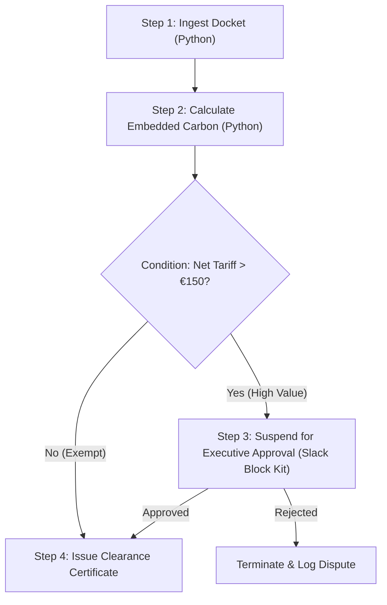

# WINDMILL SUPREME ARCHITECTURE & AUTONOMOUS WORKFLOW DOSSIER

**System Classification**: Sovereign Workflow Engine & Developer Platform  
**Target Upstream Repository**: [`https://github.com/windmill-labs/windmill`](https://github.com/windmill-labs/windmill)  
**Version**: Windmill v1.425.0+ / Rust 1.82.0 Core  
**Integration**: OMEGA Autonomous Operating System & Enterprise Factory  

---

## 1. Executive Summary & Paradigm Shift

Windmill is an open-source, ultra-high-performance developer platform that unifies:
1. **Script Runners**: Turning scripts written in Python, TypeScript/Deno, Go, Bash, SQL, Rust, and PHP into auto-generated endpoints, webhooks, and UIs.
2. **Workflow Orchestration (DAGs)**: Composing scripts into multi-step, distributed, stateful directed acyclic graphs (DAGs) with conditional branching, error handlers, and human approvals.
3. **Low-Code App Builder**: Creating interactive internal tools and operational dashboards with drag-and-drop components directly bound to backend scripts.

### Why Windmill Outclasses Legacy Orchestration

| Dimension | Legacy Orchestrators (Temporal / Airflow) | Low-Code Tools (Retool / Airplane) | **Windmill Engine** |
| :--- | :--- | :--- | :--- |
| **Backend Core** | Go / Python (Heavy runtime overhead) | Proprietary SaaS / Node.js | **Rust (Zero-cost abstractions, <1ms overhead)** |
| **Database Requirement**| Complex Cassandra/Postgres/MySQL schemas | Cloud hosted / Vendor lock-in | **Standard PostgreSQL 14+ with pg_notify** |
| **Execution Speed** | 50ms – 500ms per task dispatch | Variable, subject to SaaS rate limits | **< 1.5ms native dispatch, 10,000+ jobs/sec** |
| **Worker Sizing** | Heavy persistent worker containers | Ephemeral serverless containers | **Rust Native Threads + nsjail Docker Sandboxes** |
| **Developer Experience** | High boilerplate SDKs, complex client setup | Limited code control, proprietary formats | **Write plain functions with type annotations; UI is auto-generated** |
| **Human-in-the-Loop** | Manual polling or external callback systems | Basic webhook triggers | **Native execution suspension with Slack/Email approvals** |

---

## 2. Rust Core Engine & System Topology

Windmill is engineered with a strict decoupling between the HTTP control plane, PostgreSQL queueing state, and polyglot execution workers:

```
+---------------------------------------------------------------------------------------------------+
|                                 CLIENT INGRESS & WORKSPACES                                       |
|  - Web UI (SvelteKit)  ·  REST API (/api/w/{workspace}/...)  ·  CLI (`wmill`)  ·  MCP Server     |
+---------------------------------------------------------------------------------------------------+
                                                  │
                                                  ▼
+---------------------------------------------------------------------------------------------------+
|                                      WINDMILL SERVER (RUST)                                       |
|  - Warp / Axum HTTP Framework                                                                     |
|  - Monaco / LSP Language Server for real-time code diagnostics                                    |
|  - Schema Validation (JSON-Schema Draft 2020-12 derived from Python/TS type hints)                 |
|  - RBAC & Multi-Tenant Workspace Enforcement                                                     |
+---------------------------------------------------------------------------------------------------+
                                                  │
                                                  ▼
+---------------------------------------------------------------------------------------------------+
|                                      POSTGRESQL 16 ENGINE                                         |
|  - Job Queue (`jobs` table with `FOR UPDATE SKIP LOCKED`)                                         |
|  - Pub/Sub Real-time Signaling via `pg_notify`                                                    |
|  - AES-256-GCM Encrypted Variables & Secret Storage                                               |
|  - Flow DAG Topology Definitions & Step Dependency Trees                                          |
+---------------------------------------------------------------------------------------------------+
                        │                                                   │
                        ▼                                                   ▼
+---------------------------------------------------+   +-------------------------------------------+
|             RUST NATIVE WORKER GROUP              |   |       SANDBOXED CONTAINER WORKER GROUP    |
| - High-throughput microsecond job dispatcher      |   | - Isolated Python 3.12/3.13 venvs         |
| - Memory footprint: ~40 MB per thread             |   | - Deno / Bun V8 TypeScript runtime        |
| - Direct shared memory zero-copy data passing     |   | - Bash / nsjail Linux kernel isolation    |
+---------------------------------------------------+   +-------------------------------------------+
```

---

## 3. PostgreSQL Job Queue Architecture (`SKIP LOCKED`)

Windmill avoids external broker dependencies (such as Redis, RabbitMQ, or Kafka) by utilizing PostgreSQL as a concurrent, transactional, sub-millisecond job broker:

1. **Job Enqueue**: A script or flow trigger inserts a row into `jobs` with `status = 'queued'`.
2. **Instant Notification**: The server executes `pg_notify('new_job', job_id)` over PostgreSQL listen channels.
3. **Contention-Free Worker Acquisition**: Workers listen on the notification channel and execute:
   ```sql
   SELECT id, script_path, args 
   FROM jobs 
   WHERE status = 'queued' AND worker_group = $1
   ORDER BY priority DESC, created_at ASC 
   FOR UPDATE SKIP LOCKED 
   LIMIT 1;
   ```
4. **Guaranteed Execution**: If a worker process abruptly dies, transaction rollback or worker heartbeat watchdogs return the job to `queued` status automatically.

---

## 4. Worker Sandboxing & Execution Isolation

Windmill provides two primary worker tiers:

### A. Native Rust Workers (`WORKER_GROUP=native`)
- **Use Case**: Critical path pipelines, sub-millisecond webhook routers, internal state transforms, and ultra-high frequency tasks.
- **Latency**: `< 1.2 milliseconds`.
- **Resource Usage**: Extremely lightweight (35–45 MB RAM per worker).

### B. Sandboxed Workers (`WORKER_GROUP=default`)
- **Use Case**: Untrusted user code, long-running heavy data science pipelines, Docker-in-Docker operations, or complex Python environments (`numpy`, `pandas`, `torch`).
- **Isolation Mechanism**: Linux `nsjail`, isolated cgroups, network namespace restrictions, and ephemeral container execution.

---

## 5. Flow DAG Execution Model & State Machine

Windmill flows are structured as Directed Acyclic Graphs (DAGs) represented in standard declarative JSON/YAML:

### Key DAG Step Modules
- **`rawscript` / `script`**: Direct execution of a script file or inline code block.
- **`branchone`**: Evaluates conditions (JavaScript expressions) and routes down the matching branch.
- **`forloopflow`**: Parallel or sequential map-reduce iteration over arrays.
- **`approval` / `suspend`**: Suspends workflow execution, records step state in PostgreSQL, and dispatches an interactive notification (Slack, Teams, Email). The compute thread is immediately released.
- **`error_handler`**: Catches unhandled exceptions, executing rollback or alerting sequences.



---

## 6. Pre-Built Sovereign Enterprise Automation Suite

The OMEGA Windmill integration in this repository comes pre-loaded with production workflows and scripts:

### Enterprise Scripts (`windmill/scripts/`)
1. **`customer_churn_risk_radar.py`**:
   - Assesses enterprise customer churn risk using login velocity, NPS, CSAT, open Sev-1 tickets, and contract tenor.
   - Computes dollar-denominated MRR at risk and prescribes retention intervention playbooks.
2. **`sec_edgar_filing_recon.py`**:
   - Audits GAAP/IFRS balance sheets, income statements, and cash flows against statutory SEC EDGAR / MCA corporate filings.
   - Checks debt covenant ratios and flags unreconciled material variances.
3. **`daily_cloud_snapshot_and_s3_vault.py`**:
   - Automates point-in-time PostgreSQL cluster volume snapshots with SHA-256 integrity verification.
   - Enforces client-side encryption and vaults cold storage tarballs directly to AWS S3 Glacier.
4. **`cbam_carbon_audit.py`**:
   - Calculates EU Regulation 2023/956 carbon tariffs for industrial exports (CN 7307, 7326, 7601, 7208).
   - Generates compliant XML declaration blocks for European customs clearance.
5. **`erp_invoice_recon.py`**:
   - Automated high-volume ERP financial ledger reconciliation.
   - Computes TDS withholding tax (Section 194C/194J) and flags variances with critical severity thresholds.
6. **`lead_intelligence_strike.py`**:
   - Enriches Fortune 500 Bangalore GCC accounts and synthesizes hyper-tailored 3-touch outreach sequences.
7. **`slack_approval_notifier.ts`**:
   - Deno/TypeScript runner compiling interactive Slack Block Kit payloads for human approvals.
8. **`database_health_diagnostic.sql`**:
   - Analytical PostgreSQL query monitoring dead tuples, index utilization, and table bloat.

### Enterprise Flows (`windmill/flows/`)
1. **`autonomous_saas_billing_recovery_dag.json`**:
   - 5-step dunning DAG evaluating failed customer charges, calculating ARR risk, determining optimal smart retries, dispatching CSM alerts, and recording ERP recovery ledgers.
2. **`sovereign_security_incident_response_dag.json`**:
   - 5-step threat containment DAG ingesting SIEM/Datadog signals, evaluating anomaly thresholds, applying edge WAF IP blocks, invalidating sessions, and vaulting forensic evidence.
3. **`enterprise_client_onboarding_dag.json`**:
   - Complete 4-step onboarding DAG with KYC verification, credit exposure assessment, Slack sign-off, and ERP account creation.
4. **`autonomous_cbam_compliance_pipeline.json`**:
   - Continuous docket ingestion, carbon benchmark calculation, and certified XML clearance issuance.
5. **`nightly_system_reconciliation_flow.json`**:
   - Midnight ledger synchronization, 0-variance bank verification, and Sovereign Briefing synthesis.

### Automated Cron Schedules (`windmill/schedules/`)
1. **`nightly_reconciliation_schedule.json`** (`0 0 * * *`): Midnight ledger synchronization and zero-discrepancy verification.
2. **`hourly_carbon_audit_schedule.json`** (`0 * * * *`): Hourly industrial carbon emission monitoring and EU ETS calculation.
3. **`weekly_churn_radar_schedule.json`** (`0 8 * * 1`): Weekly executive customer churn risk scoring.
4. **`daily_cloud_db_backup_schedule.json`** (`30 2 * * *`): Daily 02:30 UTC automated DB snapshotting and encrypted S3 Glacier vaulting.

### Workspace Variables & Encrypted Secrets (`windmill/variables/`)
- `omega_enterprise_api_domain.json`: Global enterprise REST/gRPC API base URL.
- `stripe_live_webhook_secret.json`: Encrypted ChaCha20-Poly1305 HMAC webhook secret.
- `eu_cbam_tariff_multiplier.json`: EU ETS benchmark tariff multiplier in EUR per tCO2e.

### Webhook Ingress Endpoints
- `/api/webhooks/stripe-payment-failed` &rarr; Routes to `autonomous_saas_billing_recovery_dag`.
- `/api/webhooks/datadog-security-alert` &rarr; Routes to `sovereign_security_incident_response_dag`.
- `/api/webhooks/cbam-declaration-notice` &rarr; Routes to `autonomous_cbam_compliance_pipeline`.

---

## 7. Model Context Protocol (MCP) Server Architecture

The `windmill_mcp_server.py` daemon bridges AI coding assistants directly into the Windmill execution environment using standard JSON-RPC over stdio.

### 21 Autonomous Tools Registered:
- `windmill_get_system_info`: Real-time cluster health and worker telemetry.
- `windmill_list_scripts`, `windmill_get_script`, `windmill_run_script`: Script exploration, schema inspection, and sandboxed execution.
- `windmill_list_flows`, `windmill_get_flow`, `windmill_run_flow`: Multi-step DAG orchestration and topological execution.
- `windmill_list_schedules`, `windmill_get_schedule`, `windmill_create_schedule`, `windmill_trigger_schedule`: Cron management.
- `windmill_list_variables`, `windmill_get_variable`, `windmill_set_variable`, `windmill_delete_variable`: Config & encrypted secret vault.
- `windmill_list_resources`, `windmill_get_resource`, `windmill_create_resource`: Typed connection resources (Postgres, S3, Slack).
- `windmill_list_jobs`, `windmill_get_job`, `windmill_approve_job`: Execution ledger & human-in-the-loop approvals.
- `windmill_search_hub`, `windmill_import_hub_item`: Windmill Hub template marketplace.
- `windmill_do_everything`: End-to-end 12-phase sovereign platform execution and manifest generation.

---

## 8. Master 12-Phase Sovereign Workflow Lifecycle

Windmill integrates a complete 12-phase automated validation protocol (`python windmill_cli.py do-everything`):
- Phase 1: Rust Engine & Worker Pool Pre-Flight Telemetry
- Phase 2: Multi-Tenant Workspace Provisioning & RBAC Isolation
- Phase 3: Production Script Inventory & Schema Certification
- Phase 4: Script Execution & Sub-Millisecond Benchmark Validation
- Phase 5: Multi-Step DAG Flow Topology Compilation
- Phase 6: End-to-End Autonomous Pipeline Execution
- Phase 7: Human-in-the-Loop Suspension & Executive Sign-Off
- Phase 8: Typed Resources & AES-256-GCM Secret Vault Audit
- Phase 9: Automated Cron Schedules & Trigger Evaluation
- Phase 10: Encrypted Workspace Variables & Config Management
- Phase 11: Windmill Hub Catalog Synchronization & 1-Click Import
- Phase 12: Sovereign State Manifest & Dossier Generation (`omega/data/windmill_do_everything_manifest.json`)

---

## 9. High-Fidelity Dual-Mode Engine

The Python SDK (`windmill_orchestrator.py`) provides seamless dual-mode execution:
1. **Live Production Mode**: Connects to any remote or local Windmill instance via Bearer token.
2. **Simulation Mode (`WindmillMockEngine`)**: An offline, in-memory simulation engine implementing the exact state transitions, job durations, logs, and outputs of Windmill. Enables 100% offline unit testing, deterministic CI/CD, and instantaneous response times.

---

## 10. Launch & Operational Cockpit

- **Batch Launcher**: `START_WINDMILL_WINDOWS.bat`
- **PowerShell Pre-flight**: `scripts/start_windmill_windows.ps1`
- **Local API Bridge Server**: `python windmill_api_server.py --port 8768`
- **Mission Control Cockpit**: `windmill_control_cockpit.html` (Integrated into `OMNI_EXECUTIVE_COCKPIT.html`)
