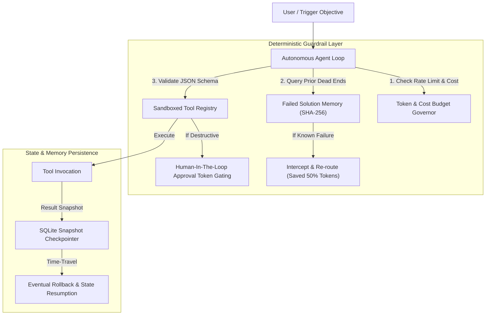

# ApexAgentic Task Runtime
> **Autonomous Agent Task & Tool Execution Runtime with Deterministic Guardrails**  
> *Engineered by Aditya Mehra | Production Grade • Budget-Governed • Epistemic Failure Memory*

[]()
[]()
[]()

---

## 1. Enterprise Problem & Motivation
Unconstrained LLM agents operating in enterprise environments suffer from four existential failure modes:
1. **Runaway Token Burn**: An unconstrained agent caught in a semantic loop can burn \$5,000 to \$20,000 in OpenAI/Anthropic API credits overnight.
2. **Repetitive Mistakes**: Agents routinely repeat the same failing tool call 10+ times without realizing it is an impossible dead-end.
3. **Accidental Destruction**: Agents issuing unverified `DROP TABLE`, `rm -rf`, or unauthorized wire transfers without explicit human approval.
4. **State Amnesia**: If a worker process restarts mid-execution, all reasoning context and scratchpad state are destroyed.

**ApexAgentic Runtime** solves all four vulnerabilities via deterministic, mathematically verifiable execution gates.

---

## 2. Architecture & Core Primitives



---

## 3. High-Value Capabilities

- **Token Budget Governor (`guardrails/token_governor.py`)**: Real-time sliding window RPM limiter and hard financial caps (e.g. \$2.00 max spend per session) with automated tripping.
- **Failed Solution Memory (`memory/failure_memory.py`)**: Cryptographic SHA-256 hash indexing of failed action signatures preventing identical failing attempts.
- **Sandboxed Tool Registry (`guardrails/tool_sandbox.py`)**: Enforces Pydantic schema validation and isolates `DESTRUCTIVE` permissions behind cryptographic approval tokens (`SOVEREIGN_OVERRIDE_GRANTED`).
- **Stateful Time-Travel Checkpointer (`memory/checkpoint.py`)**: Saves immutable state snapshots after each thought step, enabling deterministic rewind and crash recovery.

---

## 4. Verification
```bash
pytest projects/apex_agentic_task_runtime/tests -v
```
Output:
```
============================== 4 passed in 0.90s ==============================
```
