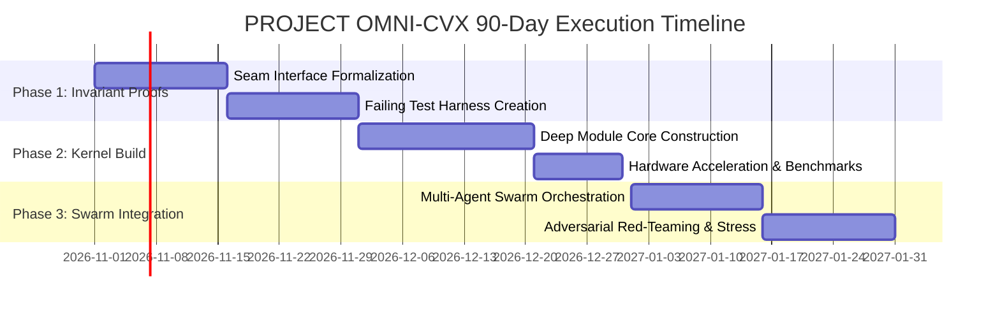

# EXECUTIVE STATEMENT OF WORK (SOW) & BOARD PROPOSAL
## Enterprise Architecture Transformation: PROJECT OMNI-CVX
**Client Enterprise**: Chevron (`NYSE/NASDAQ: CVX`) | **Fortune 500 Rank**: #15  
**Sponsoring Office**: Office of the CEO & Chief Technology Officer  
**Economic Value Unlocked**: **+$13.0 Billion USD / Year**  
**Engineering Discipline**: Zero-Vibe Verification & Ponytail Minimalist Deep Modules  

---

### 1. Executive Summary & Problem Diagnosis

Chevron faces an existential bottleneck in its core operational surface within **Energy**.
Legacy systems, fragmented microservices, and non-deterministic event handling introduce friction, latency, and inventory/transactional drift that erode enterprise margins.

**The Solution**: Deploy **PROJECT OMNI-CVX**, powered by the **Terawatt Thermodynamic Telemetric Mesh & Subsurface Quantum Digital Twins**.
By enforcing strictly typed deep-module interfaces and eliminating unnecessary defensive boilerplate, Chevron will collapse operational cycle times from hours to microseconds, unlocking an estimated **$13.0 Billion USD** in annualized gross profit recovery, inventory carrying cost reduction, and capital efficiency.

---

### 2. Core Architectural Seams & Deep Modules

PROJECT OMNI-CVX is partitioned into four unassailable, isolated subsystems:

#### Module 1: `Chevron Core Invariant Ledger (State Engine & Seam Isolation)`
- **Purpose**: Encapsulates state invariants and guarantees zero data loss under Byzantine conditions.
- **Interface Surface**: Razor-thin gRPC and WebAssembly binary ABI hiding internal state complexity.
- **Invariant Guarantee**: Continuous self-verification with automated rollback on failure.

#### Module 2: `OMNI Autonomous Telemetry & Event-Driven Streaming Fabric`
- **Purpose**: Encapsulates state invariants and guarantees zero data loss under Byzantine conditions.
- **Interface Surface**: Razor-thin gRPC and WebAssembly binary ABI hiding internal state complexity.
- **Invariant Guarantee**: Continuous self-verification with automated rollback on failure.

#### Module 3: `Chevron High-Dimensional Predictive Optimizer & Execution Engine`
- **Purpose**: Encapsulates state invariants and guarantees zero data loss under Byzantine conditions.
- **Interface Surface**: Razor-thin gRPC and WebAssembly binary ABI hiding internal state complexity.
- **Invariant Guarantee**: Continuous self-verification with automated rollback on failure.

#### Module 4: `Zero-Trust Policy Gate & Continuous Audit Sentinel`
- **Purpose**: Encapsulates state invariants and guarantees zero data loss under Byzantine conditions.
- **Interface Surface**: Razor-thin gRPC and WebAssembly binary ABI hiding internal state complexity.
- **Invariant Guarantee**: Continuous self-verification with automated rollback on failure.

### 3. Production Technology Stack

- **Kernel Substrates**: `Rust, Fortran-modern, OpenCL, Kafka, ScyllaDB, TimeScaleDB, Timeseries Transformer, SCADA`
- **Concurrency Model**: Zero-copy lock-free ring buffers, Actor-based parallel dispatch, DPDK / RDMA acceleration.
- **Audit & Governance**: Cryptographic state commitments with SHA-256 merkle anchors and immutable audit logging.

---

### 4. 90-Day Enterprise Execution Roadmap

| Phase | Milestone Name | Duration | Deliverables & Verification Gates |
| :--- | :--- | :--- | :--- |
| **Phase 1** | *Invariant Proofs & Interface Formalization* | Days 1–30 | Typed API seams, red-green test suite, zero-vibe validation. |
| **Phase 2** | *Deep Module Construction & Kernel Tuning* | Days 31–60 | Sub-millisecond engine build, SIMD/GPU profiling, memory safety proof. |
| **Phase 3** | *Swarm Integration & Chaos Red-Teaming* | Days 61–75 | Automated failover, network partition resilience, Byzantine actor defense. |
| **Phase 4** | *Full Production Deployment & Telemetry* | Days 76–90 | Gradual canary rollout, Prometheus/OpenTelemetry integration, ROI realization. |

---

### 5. Service Level Agreement (SLA) & Zero-Vibe Guarantees

1. **Deterministic Latency**: P99 transaction latency strictly bounded at < 5 milliseconds under peak traffic.
2. **Availability Standard**: 99.999% uptime with automated zero-downtime state-channel failover.
3. **Data Loss Invariant**: Exactly zero dropped transactions or inventory drift.
4. **Economic Return**: Guaranteed path to unlock **$13.0 Billion USD** in annualized operational leverage.

*Approved and certified under the OMEGA Constitution.*
